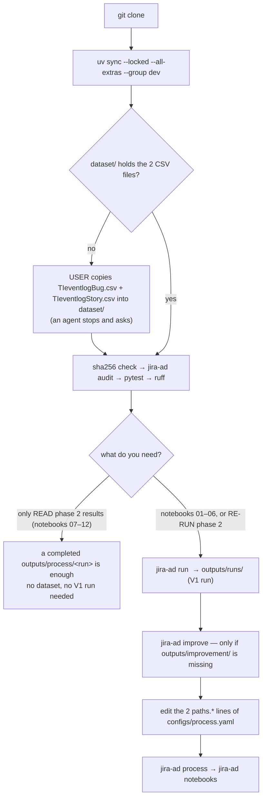

# jira_ad — detecting unusual Jira issue-handling cases

Master's thesis project: rank **closed Jira issues** by how unusual their handling history is, using a **Node2Vec** graph
representation (learned on the directly-follows graph of the training set) and an **Isolation Forest**, compared against
process statistics and n-grams. Full spec: [docs/superpowers/2026-10-16-jira-ad.md](docs/superpowers/2026-10-16-jira-ad.md);
progress, evidence and decisions: [docs/PROGRESS.md](docs/PROGRESS.md).

The repository has two phases that share one codebase:

- **Phase 1 (Tasks 1–18, done):** anomaly ranking of Jira cases (Node2Vec + Isolation Forest, and the improved `M_markov`).
- **Phase 2 (Tasks 19+):** the course project *Advanced Enterprise Resource Planning* (Vietnamese: *Hoạch định nguồn lực doanh nghiệp nâng cao*) —
  analysis, conformance checking and redesign of the bug-handling process on the same event log. See [Phase 2](#phase-2-process-analysis-conformance-checking-and-redesign-course-project).

> **Language note.** This file, `CLAUDE.md` and `AGENTS.md` are in English. Everything else (reports in `docs/`, notebooks,
> code docstrings, CLI messages, YAML comments) is in Vietnamese. Quoted CLI/notebook messages below are kept verbatim in
> Vietnamese with an English gloss so you can match them on screen.

## Read first: scope and limits of the conclusions

- **There are no real anomaly labels.** Evaluation is *semi-synthetic*: original traces (`is_injected=0`, not confirmed to be
  normal) versus structural mutants (`is_injected=1`: swap / delete / duplicate-block). The 0.5 ratio is a *design* ratio, not the
  real anomaly rate; results are **not** the accuracy of detecting real faults.
- `anomaly_score` is a continuous ranking score (higher = more unusual), **not** a probability of a process violation.
  Rare ≠ wrong; Rejected ≠ anomalous; a changed role ≠ a changed person.
- V1: the **bug** cohort, CPU only, retrospective on cases whose end is observed (DONE/Rejected), modelling only structure/order
  (time is used for EDA only). No early detection, no online operation. Story is a separate experiment and is never mixed with bug.
- Small sample (see `preprocess_audit.json`): small differences between methods may be sampling noise.

## Quick overview (read this if you are new)

**The problem.** Jira records the handling history of each issue as a time-ordered sequence of events. A shortened example of a bug issue:

```
CREATE → ADD_ISSUE_LINK → STATUS_To Investigate → EDIT_DESCRIPTION → LINK_COMMIT → … → STATUS_In Test → STATUS_DONE
```

The project ranks closed issues by how **unusual** this sequence is compared with the majority, so that a domain expert can look at
the most notable cases first. Nobody labelled the data as "anomalous", so the model learns without supervision: it learns what is
usual and then scores the deviation.
Research question: *does a graph representation (Node2Vec) help more than simple features (process statistics, n-gram counts)?*

**Processing flow** (each step is a module in `src/jira_ad/`):

```
raw CSV → normalise → split issues → build graph → learn vectors → score → evaluate
(events)  (activity,   train/val/    DFG from       Node2Vec        Isolation  mutants vs
          core view)   test          TRAIN only     (walks +        Forest     originals
                                                     Skip-gram)
```

**Glossary**

| Term | Meaning in this project |
|---|---|
| **Activity** | Normalised name of an event's action, e.g. `STATUS_In Test`, `LINK_COMMIT`, `EDIT_DESCRIPTION` |
| **Trace / case** | The sequence of activities (with roles) of one issue in time order; this is the unit of learning and evaluation, not individual events |
| **Core view** | The part of the history used by the model: up to the last terminal status update (DONE/Rejected), with generic bot noise removed |
| **DFG** | Directly-follows graph: each activity is a node, an edge A→B means B happens immediately after A, the weight is the count; built from the training set only |
| **Node2Vec** | Random walks on the DFG produce "sentences" of activities, then Skip-gram learns one vector per activity; an issue's vector is the mean/max of its activities' vectors (pooling) |
| **Isolation Forest** | The anomaly ranker: the easier an issue is to "isolate" from the majority, the higher its `anomaly_score` |
| **Mutant** | An original issue modified in a controlled way (swap two adjacent steps, delete a step, repeat a block) to serve as a test when there are no real labels |
| **AUROC** | Probability that a random mutant scores higher than a random original: 0.5 is a coin flip, 1.0 is perfect |
| **Paired win rate** | Share of mutants that score higher than *their own original issue* (compared pair by pair) |
| **Train / validation / test** | Split by issue. Everything learned (graph, vectors, model) is fitted on train only to avoid leakage; validation is for checking/choosing, test for the final report |

## Repository layout (standard folder structure)

This is the layout every command and config assumes. Paths in YAML are relative to the **repo root** (the nearest directory
containing `pyproject.toml`); absolute paths are rejected. Do not move or rename these folders.

Tags: `[git]` arrives with the clone · `[YOU]` **you must provide it** (not in Git) · `[gen]` created by a command, never edit by hand · `[lock]` never edit.

```
IS6003.11.CH/                                      repo root = the folder that contains pyproject.toml
│
├── pyproject.toml · uv.lock · .python-version   [git]  package `jira-ad`, locked dependencies, Python 3.12
├── README.md · CLAUDE.md · AGENTS.md            [git]  human docs · agent rules · agent entry point
│
├── configs/                                 [git]  ALL parameters, paths, seeds, thresholds (YAML)
│   ├── baseline.yaml · actions.yaml             [lock] phase 1 config · action → activity rules (hashed)
│   ├── experiments.yaml · improvement_plan.yaml [lock] ablation matrix · improvement protocol
│   ├── improvements.yaml · smoke.yaml               baseline + methods E/F/M · tiny plumbing run (never a result)
│   └── process.yaml                                 phase 2 config (setup may edit ONLY paths.v1_run / paths.improvement_dir)
│
├── dataset/                                 [YOU]  ◀◀◀ PUT THE DATA HERE · read-only · not in Git
│   ├── TIeventlogBug.csv                            required · 5,126 events · 161 issues
│   ├── TIeventlogStory.csv                          required · 4,439 events · 182 issues
│   └── (README.md, workflow-*.json, graph-viewer.html of the Zenodo record: optional, unused by the code)
│
├── src/jira_ad/                             [git]  all logic: 34 modules + __init__.py (see Module map)
├── tests/                                   [git]  test_<module>.py per module + conftest.py + helpers.py
├── notebooks/                               [git]  01–06 phase 1 · 07–12 phase 2
├── scripts/                                 [git]  execute_notebooks.py (wrapper of `jira-ad notebooks`)
├── docs/                                    [git]  reports · PROGRESS.md · DECISIONS.md · RESEARCH_NOTES.md · figures/
│   └── superpowers/                                spec (phase 1) and plans/ (improvement, phase 2)
│
├── .venv/                                   [gen]  created by `uv sync`
└── outputs/                                        append-only: a run folder is never overwritten
    ├── analysis/                            [gen]  `audit`   → audit_raw.json
    ├── prepared/<cohort>-<key>/             [gen]  `prepare` → normalised data + split
    ├── runs/<UTC>-<hash8>/                  [gen]  `run`, `experiments` → phase 1 runs · git-ignored
    ├── improvement/<UTC>-<hash8>/           [gen]  `improve` → out-of-fold scores of the 161 issues
    └── process/<UTC>-<hash8>/               [gen]  `process` → phase 2 run: a_quant … e_ranking, notebooks_executed
```

**Folder contract** — who creates each folder, and what an agent may do there:

| Path | Created by | Git | Needed for | An agent may |
|---|---|---|---|---|
| `dataset/TIeventlogBug.csv`, `dataset/TIeventlogStory.csv` | **the user** (copy from Zenodo) | ignored (`dataset/`) | `audit`, `prepare`, `run`, `improve`, `process` | never write, replace or download them; may create the *empty* `dataset/` folder to show where they go |
| `.venv/` | `uv sync` | ignored | everything | create only through `uv` |
| `outputs/runs/` | `jira-ad run`, `experiments` | ignored (`outputs/runs/*`) | notebooks 01–06; `process` step E (Node2Vec) | create only through the commands; never delete or overwrite an existing run |
| `outputs/improvement/` | `jira-ad improve` | not ignored | `process` step E (`M_markov` dimension) | same |
| `outputs/process/` | `jira-ad process` | not ignored | notebooks 07–12 | same |
| `outputs/analysis/`, `outputs/prepared/` | `audit`, `prepare` | not ignored | cache of the pipeline | same |
| `configs/{baseline,actions,experiments,improvement_plan}.yaml` | — | yes | — | never edit |
| `configs/process.yaml` | — | yes | phase 2 | only the two `paths.*` lines, and only as a setup step (step 6) |

"Git" follows the current `.gitignore`: it ignores `.venv/`, caches, `dataset/` and `outputs/runs/*`. Everything else under `outputs/` is not ignored,
so it arrives with a clone only if it was committed.

**Setup flow at a glance** (details in the next section):



Rules that follow from the layout:

- `dataset/` is read-only input. `outputs/` is append-only: a run directory is never overwritten.
- `<UTC>` is the creation time and `<hash8>` the first 8 hex characters of the config hash, so **a re-run has a different folder name**
  (the same config gives the same hash and, on the same environment, the same numbers).
- A fresh clone contains no `dataset/` and no `outputs/runs/`; see the next section for how to supply or regenerate them.

## Setup from scratch (fresh clone → working code)

Follow these steps in order. Steps 1–4 are enough to run the tests and the audit; steps 5–7 regenerate the git-ignored artifacts under
`outputs/`, and only the ones you need.

**0. Prerequisites**

- Python 3.11–3.12 (developed with 3.12.7).
- [`uv`](https://docs.astral.sh/uv/) (recommended; it reads `uv.lock`).
- Optional, for phase 2 figures: Graphviz (`dot` on `PATH`, e.g. `brew install graphviz`). Without it, phase 2 still runs but writes
  only the `.dot` sources — **no PNG/SVG** (`process_figures.render_dot` skips them silently).

**1. Get the code**

```bash
git clone <repo-url> zenodo && cd zenodo
```

**2. Install dependencies**

```bash
# Option 1 (recommended, uses uv.lock; includes notebook, process/pm4py and dev tools)
uv sync --locked --all-extras --group dev

# Option 2 (pip, ignores the lock — versions are resolved by pip). Note the `process` extra: without it pm4py is missing
# and phase 2 step C (conformance) fails.
python3 -m venv .venv && source .venv/bin/activate
pip install -e '.[notebook,dev,process]'
```

Both options were run before the `process` extra existed, and Option 2 gave a green `pytest` too. Option 2 *with* `process` has not been
re-verified since that extra was added; `uv.lock` is the supported path.

**3. Put the dataset in `dataset/`** (not in Git, so you must provide it)

- **Exact location:** `<repo root>/dataset/TIeventlogBug.csv` and `<repo root>/dataset/TIeventlogStory.csv`, directly inside `dataset/` (create the
  folder with `mkdir -p dataset` if it does not exist). The loader also finds them in sub-folders of `dataset/`, but two files with the same name are an
  error, so keep the flat layout.
- Source: Zenodo record [8275679](https://zenodo.org/records/8275679), which accompanies the paper *Process Mining from Jira Issues at a
  Large Company* (ICSME 2023). The two CSV files are the event logs of "Team Newt". See the record page for its terms of use.
  The other files of the record (`README.md`, `workflow-*.json`, `graph-viewer.html`) are optional and unused by the code.
- Do not edit, rename or re-save these files. **AI agents must not download the dataset themselves** (project rule); the user places the files.
- Quick check that both files are in place (prints nothing when they are):

  ```bash
  for f in dataset/TIeventlogBug.csv dataset/TIeventlogStory.csv; do [ -f "$f" ] || echo "MISSING: $f"; done
  ```

- Reference SHA-256 of the copies used for every existing run (recorded in their manifests):

  | File | Events | SHA-256 |
  |---|---|---|
  | `TIeventlogBug.csv` | 5,126 | `cda16f1c5c4af641ea89e77ac5b8217c5f5a923988e7984a73e80f159f38de80` |
  | `TIeventlogStory.csv` | 4,439 | `afd53fca100a90c5e4c63360d14c84bd1f9109d2670fc7b8184e57a52c8b6387` |

  A different hash means a different dataset version: the numbers in the reports will not reproduce.

**4. Verify the installation and the data**

```bash
shasum -a 256 dataset/TIeventlogBug.csv dataset/TIeventlogStory.csv        # compare with the table above
uv run jira-ad audit --config configs/baseline.yaml                        # also compares counts with `reference_counts`
uv run pytest -q
uv run ruff check src tests scripts
```

`audit` writes `outputs/analysis/audit_raw.json` and prints any difference from the reference counts (5,126 events / 161 issues for bug,
4,439 / 182 for story). Without `dataset/` it stops with `Lỗi: Thư mục dữ liệu không tồn tại: dataset` ("error: data folder does not exist").
The tests build their own tiny fake repositories (`tests/helpers.py`) and need neither `dataset/` nor `outputs/`.

**5. Choose what you need, then regenerate only that**

| Goal | What it needs |
|---|---|
| Only **read** the phase 2 results and re-run notebooks 07–12 | A completed `outputs/process/<run>` whose config hash matches the current `configs/process.yaml` (the author's run `20261026T025412Z-399b0a40` does, while `process.yaml` is unedited). **No dataset and no V1 run** (verified on a clean copy). If you did edit `process.yaml`, pass the run explicitly: `uv run jira-ad notebooks --run-dir outputs/process/<run>`. |
| Notebooks 01–06 (phase 1) | Dataset + a V1 run: `uv run jira-ad run --config configs/baseline.yaml` (a few seconds). |
| **Re-run** phase 2 (`process`) with the Node2Vec and `M_markov` parts | Dataset + a V1 run + an improvement folder (below), then step 6. |

```bash
uv run jira-ad run     --config configs/baseline.yaml            # → outputs/runs/<UTC>-930f8a85/   (V1 run; 3.3 s on the verified copy)
ls -d outputs/improvement/*-bb0fee9a                              # already there? then skip the next line
uv run jira-ad improve --plan configs/improvement_plan.yaml      # → outputs/improvement/<UTC>-bb0fee9a/   (~90 s)
```

**6. Point phase 2 at those folders** (only to re-run `process`)

`configs/process.yaml` hard-codes two timestamped folders from the author's machine:

```yaml
paths:
  v1_run: outputs/runs/20261017T081309Z-930f8a85
  improvement_dir: outputs/improvement/20261022T151529Z-bb0fee9a
```

`outputs/runs/` is git-ignored, so `v1_run` never exists on a fresh clone. Find the folders that step 5 produced and change **only those two lines**
(use the newest `-930f8a85` folder for `v1_run`, and an existing `-bb0fee9a` folder for `improvement_dir`):

```bash
ls -d outputs/runs/*-930f8a85          # the V1 run (930f8a85 = hash8 of configs/baseline.yaml)
ls -d outputs/improvement/*-bb0fee9a   # the improvement run
uv run jira-ad process --config configs/process.yaml           # steps A–E → outputs/process/<UTC>-<hash8>/
uv run jira-ad notebooks --run-dir outputs/process/<run>       # notebooks 07–12
```

Editing those lines changes the config hash, so the new run's `<hash8>` differs from the author's `399b0a40`. If the two folders are missing,
`process` still completes but step E silently drops the Node2Vec comparison and the `M_markov` dimension (it writes a note in
`e_ranking/status.json`), so the result differs from the reports. Existing reports quote the numbers of the author's run
`outputs/process/20261026T025412Z-399b0a40`.

**7. Open notebooks by hand (optional)**

In VSCode/Jupyter choose the `.venv` kernel (named `jira-ad`) and run from the first cell. Notebooks pick the newest completed run whose
`config_hash` matches the current config (see Commands).

### What was verified

On a clean copy of the sources (no `.venv`, no `outputs/`; the two CSV files copied from the author's folder, **not downloaded** from Zenodo),
macOS, Python 3.12, `uv.lock`, on 2026-10-27:

| Step | Result |
|---|---|
| `uv sync --locked --all-extras --group dev` | ok |
| `jira-ad audit` | ok: 5,126 events / 161 issues (bug), 4,439 / 182 (story); without `dataset/` it stops with the error quoted in step 4 |
| `uv run pytest -q` | 705 passed in 3 min 40 s (no `outputs/` needed) |
| `jira-ad run` / `jira-ad improve` | ok, 3.3 s / about 90 s |
| `jira-ad process` without the V1 and improvement folders | ok but degraded (step E drops Node2Vec and `M_markov`, as described above) |
| `jira-ad process` after step 6, then `jira-ad notebooks` | ok; notebooks 07–12 ran in about 20 s |
| Same notebooks with `dataset/` and `outputs/runs/` removed | ok |
| Regenerated phase 2 run vs the author's run `20261026T025412Z-399b0a40` | 74 of 75 data files byte-identical (PNG/SVG, manifest and executed notebooks not compared); the only difference is `e_ranking/status.json`, which records folder paths |

Not verified: the pip route (Option 2) with the `process` extra, a real download from Zenodo, and other OS/CPU (bitwise equality is not guaranteed).

### What is in Git and what is not

| Arrives with a clone (if committed) | Ignored by Git (you create it) |
|---|---|
| `src/`, `tests/`, `configs/`, `notebooks/`, `docs/`, `scripts/`, `pyproject.toml`, `uv.lock`, `.python-version`, and `outputs/{analysis,prepared,improvement,process}/` (not git-ignored) | `dataset/` (provide it, step 3) · `outputs/runs/*` (regenerate, step 5) · `.venv/` (step 2) · caches |

## Commands

The raw data lives in `dataset/` (read-only). Every command below has been run on the real data; with Option 2 drop the `uv run` prefix.

```bash
uv run jira-ad audit   --config configs/baseline.yaml   # fingerprint + raw-data statistics -> outputs/analysis/audit_raw.json
uv run jira-ad prepare --config configs/baseline.yaml   # normalise, core view, fixed split -> outputs/prepared/<cohort>-<key>/
uv run jira-ad run     --config configs/baseline.yaml   # prepare -> fit A–D (train) -> mutants -> score -> evaluate -> outputs/runs/<run_id>/
uv run jira-ad experiments --config configs/experiments.yaml    # ablation matrix: 12 experiments × 3 model seeds = 36 runs (~2 min)
uv run jira-ad improve --plan configs/improvement_plan.yaml     # improvement phase: E/F/M, cross-validation, applicability levels (~90 s)
uv run jira-ad compare --runs-dir outputs/runs          # merge runs of the same protocol (mean/std over model seeds)
uv run jira-ad score   --bundle outputs/runs/<run_id>/models/D_hybrid/bundle.joblib \
                       --input-csv dataset/TIeventlogBug.csv --output scored.csv   # score with a saved bundle, no refit
uv run jira-ad notebooks --run-dir outputs/runs/<run_id>  # run notebooks 01–06 (nbclient, clean kernel) on one V1 run
uv run pytest -q
uv run ruff check src tests scripts
```

`<run_id>` is the real value that `run` prints (`Run dir: ...`), not a string to copy verbatim. `configs/smoke.yaml` exists only to check
the software (tiny embedding/trees); **never use smoke numbers as research results**.

Phase 2 commands (`process`, `check-report`, `blind-review-compare`, and `notebooks` on a process run) are listed in the Phase 2 section.

### Use as a Python library

Run from the repo root (in an empty notebook or `uv run python`):

```python
from jira_ad.config import load_config
from jira_ad.pipeline import prepare
from jira_ad.detector import fit_detector, score_traces

cfg   = load_config("configs/baseline.yaml")
prep  = prepare(cfg)                                    # normalise -> core view -> train/val/test split (reused if it already exists)
train, test = prep.traces_for("train"), prep.traces_for("test")
bundle = fit_detector(train, cfg, "D_hybrid")           # learns on train only; method: A_stats | B_ngrams | C_embedding | D_hybrid
scores = score_traces(bundle, test).sort_values("anomaly_score", ascending=False)
print(scores[["trace_id", "anomaly_score", "n_events"]].head())
```

A larger `anomaly_score` means more unusual (a continuous ranking, not a probability of a violation). To inspect one case:
`test[0].activities`, `.roles`, `.terminal_status`.
To score a raw CSV file with a saved model without refitting, use the `jira-ad score` command above.

**Notebooks** (`notebooks/01…06`, in Vietnamese): data audit, process exploration, Node2Vec diagnostics, model comparison, real cases,
ablations and limits. They only read the artifacts of one run (no refit) and stop with an error naming the exact command to regenerate
if an artifact is missing/changed or the input data no longer matches the fingerprint in the manifest. `jira-ad notebooks` (or
`python scripts/execute_notebooks.py --run-dir …`) runs each notebook in a fresh kernel of the very environment in use, cwd = repo root,
`allow_errors=False`, timeout from `notebooks.timeout_seconds`, and saves the executed copy to `<run>/notebooks_executed/`
(with `execution_log.json`); the source notebook is not overwritten. Notebooks 01–02 read the full view, so they are labelled `analysis_only`.
Opening by hand (VSCode/Jupyter): pick the kernel of `.venv` (named `jira-ad`) and run from the first cell; if no run is specified, the
notebook **automatically picks the newest completed run whose `config_hash` equals the current `configs/baseline.yaml`** (it still checks
every fingerprint, and the header prints a `chọn run` line — "run chosen" — telling you which run). If the config changed or no matching run
exists yet, it stops with an error naming the command `uv run jira-ad run --config configs/baseline.yaml`.
To choose another run: set the environment variable `JIRA_AD_RUN_DIR=outputs/runs/<run_id>` (relative paths are resolved from the repo root) or use
`uv run jira-ad notebooks --run-dir ...`.

### What the six phase 1 notebooks say

Read them in order. Notebooks do not retrain; they read the results of a run to visualise and interpret. Each has a **Nhận xét**
("Remarks", regenerated from the numbers on every run) section and a **Giả thuyết và giới hạn** ("Assumptions and limits") section; read both.

| Notebook | Question it answers | Read it to understand |
|---|---|---|
| `01_data_audit` | What is in the data, what is missing? | Number of events/issues, blank roles and bots, row order, raw → core funnel, excluded cases; why conclusions apply only to closed cases |
| `02_process_exploration` | What does the real process look like? | Number of trace variants (almost no two cases are alike), differences between the DONE and Rejected branches, the DFG picture, dwell time per status |
| `03_embedding_diagnostics` | How does the embedding part behave? | Walks, the effect of p/q, coverage of activities unseen in train, why cosine is not a transition probability, why pooling is "order-blind" |
| `04_model_comparison` | Which method is better? | The main results notebook: AUROC per mutant type, bootstrap intervals and permutation test, paired differences among A–D, positive control, stability over model seeds |
| `05_case_studies` | Which cases does the model rank high, and are they worth looking at? | Individual high-scoring issues: the original sequence, the most "surprising" transitions, roles; the agent's exploratory review |
| `06_ablations_and_limits` | What happens when each factor is changed? | Undirected walks, p/q, dimensions, cross-fit, temporal holdout; the two hypotheses checked under the pre-locked rule; measured technical limits |

Notebooks 07–12 belong to phase 2 (see below).

### Troubleshooting

| Symptom | Cause and fix |
|---|---|
| The first notebook cell reports `Chưa chỉ định run` ("no run specified") or `Chưa có run hoàn tất nào khớp configs/baseline.yaml hiện tại` ("no completed run matches the current configs/baseline.yaml") | No run matches the current config: run `uv run jira-ad run --config configs/baseline.yaml`, or set `JIRA_AD_RUN_DIR` |
| You edited code in `src/jira_ad/` but the notebook still behaves as before | The kernel still holds the old module in memory: **Restart** the kernel and run again |
| VSCode asks to choose a kernel, or `ModuleNotFoundError: jira_ad` | Choose the kernel of `.venv` (named `jira-ad`); run `uv sync --locked --all-extras --group dev` if `.venv` does not exist yet |
| `Lỗi: Thư mục dữ liệu không tồn tại: dataset` ("error: data folder does not exist") from `audit`/`prepare`/`run`/`improve`/`process` (checked) | `dataset/` is missing: put `TIeventlogBug.csv` and `TIeventlogStory.csv` in `<repo root>/dataset/` (Setup, step 3). A failed `process` leaves an empty `outputs/process/<UTC>-<hash8>/` folder; it has no `manifest.json`, so it is never picked up, and it is safe to delete |
| Error `không còn khớp fingerprint` ("no longer matches the fingerprint") or `Đầu vào … đã đổi sau khi chạy run` ("input … changed after the run") | The data or an artifact of the run was modified after the run: re-run the command that the error message prints |
| `PrepareError … đã có nhưng khác nội dung tính lại` ("… exists but differs from the recomputed content") | A folder in `outputs/prepared/` does not match the recomputed result: delete that folder and run again |
| `ModuleNotFoundError: pm4py` in phase 2 | The `process` extra is not installed: use `uv sync --locked --all-extras --group dev`, or `pip install -e '.[notebook,dev,process]'` |
| Phase 2 figures are missing (only `.dot` files) | Graphviz `dot` is not on `PATH`: install Graphviz and re-run `process` (a new run folder is created) |
| Phase 2 step E reports `không có run V1 …` ("no V1 run …") or `bỏ chiều M_markov` ("dropped the M_markov dimension") in `e_ranking/status.json` | `paths.v1_run` / `paths.improvement_dir` in `configs/process.yaml` point to folders that do not exist: see Setup, step 6 |
| Gensim prints `Exception ignored in … our_dot_float` | Known, deterministic, and does not make vectors non-finite (see Reproducibility) |

## Phase 2: process analysis, conformance checking and redesign (course project)

Applies the six lectures of *Advanced Enterprise Resource Planning* to the same event log. Plan:
[docs/superpowers/plans/2026-10-26-do-an-mon-hoc.md](docs/superpowers/plans/2026-10-26-do-an-mon-hoc.md); report:
[docs/BAO_CAO_MON_HOC.md](docs/BAO_CAO_MON_HOC.md); approved decisions: the "Approved decisions" section of [CLAUDE.md](CLAUDE.md).

```bash
uv run jira-ad process --config configs/process.yaml          # steps A–E → outputs/process/<UTC>-<hash8>/
uv run jira-ad notebooks --run-dir outputs/process/<run>      # notebooks 07–12 (recognises a phase 2 run)
uv run jira-ad check-report --report docs/BAO_CAO_MON_HOC.md --run-dir outputs/process/<run>
uv run jira-ad blind-review-compare --run-dir outputs/process/<run> --labels <filled blind table>   # unlock the blind table, top vs random
```

| Step | Folder inside the run | Module | Notebook | Lecture |
|---|---|---|---|---|
| A. Status log + quantitative analysis | `a_quant/<cohort>/` | `status_log.py`, `worktime.py`, `process_metrics.py` | `07_quantitative` | B2 |
| B. Norms + centrality | `b_norms/` | `norms.py`, `centrality.py` | `08_norms_centrality` | B3 |
| C. Work System, reference model, discovery, replay | `c_conformance/` | `conformance.py` (pm4py, extra `process`) | `09_conformance` | B1, B5 |
| D. BPR, AS-IS/TO-BE KPIs | `d_bpr/` | `bpr.py` | `10_bpr` | B4 (+ B2) |
| E. Representation + ranking | `e_ranking/` | `ranking.py` | `11_ranking` | B6 |
| F. Summary + number cross-check | — | `process_report.py` | `12_summary_report` | summary |

Shared infrastructure: `process_config.py` (reads `configs/process.yaml`, checks keys), `process_run.py` (run folder, manifest, fingerprint
of the locked inputs, `code.sha256`), `process_analysis.py` (notebook loader, auto-picks the newest run matching the config, remarks generated
from the numbers), `process_plots.py`, `process_figures.py` (Graphviz). Notebooks 01–06 run only on a V1 run (`outputs/runs/`), 07–12 only on
a phase 2 run (`outputs/process/`).

Phase 2 inputs beyond `dataset/`: the V1 run in `paths.v1_run` (Node2Vec vectors, never refitted) and the improvement folder in
`paths.improvement_dir` (out-of-fold `M_markov` scores of the 161 issues). Both are optional at run time but needed to reproduce the reports (Setup, step 6).

## Input data

The CSV has exactly four columns `issueKey, timestamp, role, action` (strict schema: a missing/extra column is an error).
`timestamp` is ISO 8601 **with an offset** (e.g. `2022-06-21T22:40:38.856-0700`; a missing timezone is rejected); rows may be out of
time order (they are stably sorted by `case_id`, UTC time, `source_row`). `role` may be blank. The two files are looked up by name
under `data.root` (recursively); several files with the same name are an error and require an explicit path in the config.

## Output (`outputs/runs/<run_id>/`)

| File | Content |
|---|---|
| `manifest.json` | `status` (running/completed/failed), `run_id`, `config_hash`, hashes of data/rules/split, seeds, Git commit (if any), package versions, time per stage, hash of each artifact |
| `config.resolved.yaml`, `input_files.json` | resolved config; sha256, size and line count of the input files and `actions.yaml` |
| `split_manifest.csv`, `exclusions.csv`, `preprocess_audit.json` | train/validation/test split by issue; excluded cases with reasons; raw → core funnel |
| `graph.graphml`, `node_vectors.parquet`, `walk_sample.json`, `embedding_diagnostics.json` | the train DFG and the shared embedding |
| `models/<method>/` | `bundle.joblib` (encoder + Isolation Forest + metadata, including the content of `actions.yaml`), `feature_schema.json`, `fit_metadata.json` |
| `scores/originals.parquet`, `scores/mutants.parquet` | `method, trace_id, parent_case_id, split, anomaly_score` + OOV coverage |
| `mutation_ledger.csv`, `mutations.parquet` | mutation ledger (including skipped cases + reason) and the mutant contents |
| `metrics.json`, `metrics_by_type.csv`, `paired_scores.csv` | AUROC, AP, paired win rate per (split, method, mutation type) with n, design ratio and the AP of a constant predictor |
| `case_review_blinded.csv`, `case_review_key.csv` | 20 test cases for review (top 10 + 10 random); the blind table has no score/rank/model, the review columns are blank |
| `bootstrap_intervals.csv`, `bootstrap_differences.csv` | bootstrap intervals by `parent_case_id` (AUROC, paired win rate; per type and macro) and paired differences between methods; all methods share the same resamples |
| `chance_test.csv` | within-pair permutation test: whether AUROC differs from 0.5, per (method, type), with the SD of AUROC under the null |
| `positive_control.csv`, `positive_control_ledger.csv`, `positive_control_paired_scores.csv` | positive control (shuffle the whole interior) **on validation only**; checks the machinery, it is not a V1 mutation type |
| `reviews/` | the agent's exploratory review (optional, outside the hashed artifact set) |
| `tables/`, `figures/`, `notebooks_executed/`, `run.log` | extra tables; PNG figures and the tables behind them, executed notebooks (written by `jira-ad notebooks`, outside the hashed artifact set); log |

A failed run leaves a `manifest.json` with `status: failed` and `error.stage`; `completed` only when every artifact was written and the metrics
could be computed. A run never overwrites another run.

## Method (summary)

- **Normalisation**: one CSV row = one event; activity = verb + field name (the value is not stored), `STATUS_<value>` when the row has a status
  update; priority rules in `configs/actions.yaml`. **Core view**: keep up to the *last* terminal status update (keeping every reopen loop),
  drop generic `RemoteIssueLink` updates; cases that do not end at a terminal status are excluded with a reason.
- **Split** by issue (not by event), seed 42, stratified by `terminal_status`; everything learned is fitted on train only.
- **Four configurations**: `A_stats` (10 process statistics H), `B_ngrams` (unigram + ordered bigram + H), `C_embedding` (mean/max pooling of
  Node2Vec vectors + `unseen_node_ratio`), `D_hybrid` (pooling + H). Nodes/transitions unseen in train → a zero vector and the `unseen_*` ratios.
- **Node2Vec** is sampled by our own code (with probability checks) and then uses Gensim Skip-gram. Directed convention: after the edge `t→v`,
  choose `v→x` ∝ `w(v,x)·bias(t,x)` with bias `1/p` if `x=t` (only when the edge `v→t` exists), `1` if the edge `x→t` exists, `1/q` otherwise.
- **Evaluation**: single-edit mutants (`swap_adjacent`, `delete_internal`, `duplicate_block`) generated from parents in validation/test (never
  train); the first/last events are protected. Metrics per type, methods compared on the same set of parents.

## Results and how to read them

Real results, limits and conclusions (including negative results) are in [docs/RESEARCH_NOTES.md](docs/RESEARCH_NOTES.md); the numbers come from the
runs in `outputs/runs/` via notebooks 04, 05, 06. Summary:
with single-edit mutants and a holdout of ~31 cases, the methods detect a **very small** effect (macro AUROC 0.51–0.54) for `delete_internal` and
`duplicate_block`, not for `swap_adjacent`; `D_hybrid` is higher than `B_ngrams` on both validation and test (the parent-bootstrap interval excludes 0)
but is **not shown** to beat `A_stats` (the interval contains 0); train cross-fit of features and reducing the embedding dimension did not improve
validation. Confidence intervals use a parent bootstrap and a within-pair permutation test because the data are paired (the two independent-sample
formula is too wide).
`configs/experiments.yaml` runs one factor at a time with three model seeds; the decision rule for the three main comparisons (the `decision` block) was
locked before running and selects on validation only, the rest are exploratory sensitivity checks, not used to choose a configuration.
The new options (`features.cross_fit_folds`, `split.strategy: temporal`, the `evaluation` section), when absent from the YAML, keep V1 behaviour and do
not change `config_hash`.

**Improvement phase (2026-10-22, `jira-ad improve`, details in [docs/BAO_CAO_CAI_TIEN.md](docs/BAO_CAO_CAI_TIEN.md) and [docs/BAO_CAO_TONG_KET.md](docs/BAO_CAO_TONG_KET.md)):**
three methods were added — `E_score_fusion` (fuses the scores of two Isolation Forests), `F_edge_hybrid` (edge-based embedding), `M_markov` (mean
transition surprisal on the DFG, no Isolation Forest).
Under the pre-locked rule on validation, no method is confirmed better than `D_hybrid` (`M_markov` +0.032 [−0.008, +0.088]), so `D_hybrid` remains the
recorded configuration.
Cross-validation on the 161 issues (exploratory): `M_markov` 0.603 [0.588, 0.621] versus `D_hybrid` 0.554, positive control 0.979, best at detecting
reversed order — the best candidate, which needs confirmation on new data.
No method is enough for automatic alerting (skipping one status step reaches AUROC ≤ 0.57); `M_markov` suits a retrospective review-suggestion list with
a human deciding.

## Reproducibility

Seeds are in `configs/*.yaml`; Gensim runs with `workers=1`. Gensim 4.4.0 may print `Exception ignored in … our_dot_float` in some runs: the message is
deterministic given data/seed and does not make vectors non-finite (measured bit-identical across two numpy/scipy sets), but the root cause is unknown.
The same config + the same environment give the same scores (a test checks this), but **bitwise equality across OS/CPU is not guaranteed**. The lock is
in `uv.lock`. Loading `bundle.joblib` runs pickle code: **only load files you created yourself**.

## Module map (`src/jira_ad/`)

Read in this order if you want to understand the code.

**Phase 1**

| Module | Role |
|---|---|
| `config.py` + `configs/*.yaml` | All research parameters, paths, seeds; a different experiment = edit the YAML. `actions.yaml` holds the action normalisation rules |
| `data.py`, `preprocess.py`, `types.py` | Read the CSV, normalise actions into activities, cut the core view, the `Trace` type |
| `splits.py` | Split train/validation/test by issue (random or temporal) |
| `graph.py`, `walks.py`, `embedding.py` | DFG from train, Node2Vec random walks, Skip-gram vectors |
| `features.py`, `detector.py` | Features A–D (including optional cross-fit) and Isolation Forest, save/load bundle |
| `mutations.py`, `evaluation.py` | Mutants and positive control, AUROC/AP, parent bootstrap, within-pair permutation test |
| `pipeline.py`, `cli.py`, `experiments.py` | Wire the steps into `jira-ad run`, `compare`, `score`, `experiments` |
| `crossval.py`, `improvement.py` | Improvement phase: cross-validation by issue, pre-locked verdicts, inference profile and applicability levels (`jira-ad improve`) |
| `analysis.py`, `plots.py`, `notebook_runner.py` | Helpers for notebooks, figures, running notebooks with nbclient |

**Phase 2**

| Module | Role |
|---|---|
| `process_config.py` + `configs/process.yaml` | Phase 2 parameters: calendar, back-fill threshold, work/wait states, norm percentile, reference model, flag rules, BPR thresholds, ranking |
| `worktime.py`, `status_log.py` | Working-day seconds from the original offset; one row per status visit, reusing the phase 1 core view |
| `process_metrics.py` | CT = PT + WT, CTE, Little's law, FPY, gate roles, AS-IS KPI table (Chapter 2) |
| `norms.py`, `centrality.py` | Statistical norms (P75 of historical dwell), late visits; DFG centrality joined with delay (Chapter 3) |
| `conformance.py`, `process_figures.py` | Reference model, Petri net, Alpha/Heuristics/Inductive discovery, token replay, flag rules, BPMN XML, Work System table (Chapters 1 and 5) |
| `bpr.py` | Candidate checks with pre-locked thresholds, what-if recomputation on the log, AS-IS/TO-BE KPIs, pilot plan (Chapter 4) |
| `ranking.py` | Representation comparison (reuses V1 vectors), multi-dimension profile, "look first" ranking, blind review table (Chapter 6) |
| `process_run.py`, `process_analysis.py`, `process_plots.py`, `process_report.py` | Orchestration of steps A–E with manifest, notebook loader and generated remarks, figures, cross-check of report numbers against artifacts |

Other directories: `notebooks/` (twelve notebooks) · `scripts/` · `tests/` (one test file per module) · `docs/` · `dataset/` (raw, read-only, not in Git) ·
`outputs/` (artifacts; `outputs/runs/*` is git-ignored). Agent guidance: [AGENTS.md](AGENTS.md) · [CLAUDE.md](CLAUDE.md).

Documents: [docs/BAO_CAO.md](docs/BAO_CAO.md) (thesis report, V1), [docs/BAO_CAO_CAI_TIEN.md](docs/BAO_CAO_CAI_TIEN.md) (improvement phase),
[docs/BAO_CAO_TONG_KET.md](docs/BAO_CAO_TONG_KET.md) (summary report), [docs/BAO_CAO_MON_HOC.md](docs/BAO_CAO_MON_HOC.md) (phase 2 course report),
[docs/PROGRESS.md](docs/PROGRESS.md) (progress, evidence), [docs/DECISIONS.md](docs/DECISIONS.md) (differences from the plan),
[docs/RESEARCH_NOTES.md](docs/RESEARCH_NOTES.md) (observations / hypotheses / conclusions).

**Suggested reading path.** 30 minutes: the Quick overview above, then notebooks 02 and 04. Another hour: notebook 03, `graph.py`, `features.py`.
When preparing the defence: the Limits section of `docs/BAO_CAO.md` and the "Read first" notes at the top of this README.
