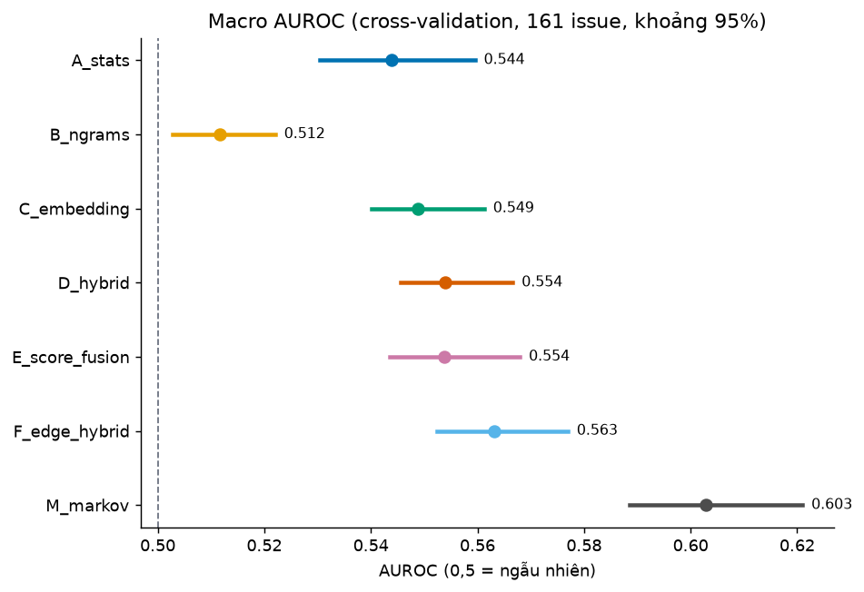
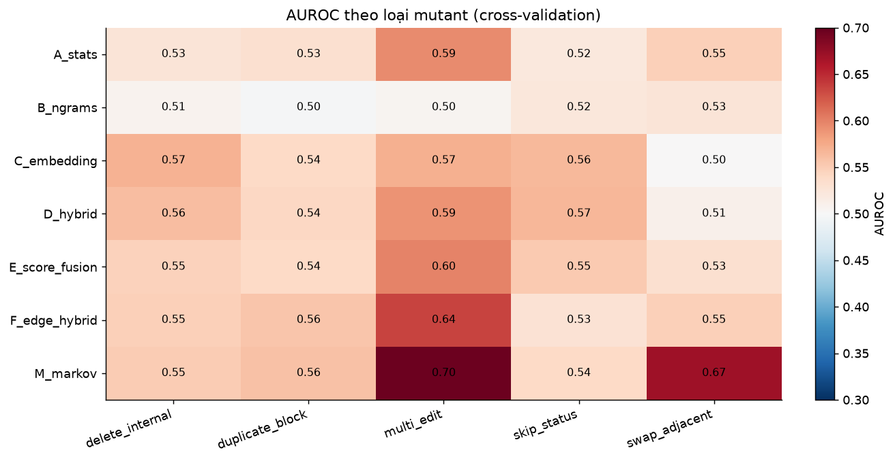

# Báo cáo giai đoạn cải tiến: phương pháp mới, đánh giá lại và khả năng ứng dụng

Đồ án môn học — phát hiện các ca xử lý Jira khác thường (Node2Vec + Isolation Forest). Báo cáo này nối tiếp [BAO_CAO.md](BAO_CAO.md) (phương án V1).

> **Nguồn số liệu.** Mọi số lấy từ `outputs/improvement/20261022T151529Z-bb0fee9a/`, do lệnh `uv run jira-ad improve --plan configs/improvement_plan.yaml` tạo ra. Lệnh đã chạy hai lần; các bảng kết quả giống hệt, chỉ cột thời gian đo khác.
> Thư mục này chứa ba run của giao thức 1: `20261022T151529Z…`, `…151534Z…`, `…151540Z…` trong `outputs/runs/`.
> Không có nhãn bất thường thật, nên mọi metric đều là đánh giá **bán tổng hợp**, không phải độ chính xác phát hiện lỗi thực tế.

## 1. Tóm tắt

1. Đã thêm ba phương pháp, mỗi phương pháp nhắm vào một điểm yếu đã đo của V1:
   - `E_score_fusion`: gộp điểm thay vì ghép cột;
   - `F_edge_hybrid`: embedding theo **cạnh**, có thấy thứ tự;
   - `M_markov`: điểm bằng surprisal chuyển tiếp trung bình, không dùng Isolation Forest.

   Đã thêm hai loại mutant: `skip_status` (bỏ một bước trạng thái) và `multi_edit` (ba chỉnh sửa).
2. **Theo quy tắc quyết định khóa trước** (validation, 33 parent, Bonferroni cho 3 ứng viên), **không ứng viên nào được xác nhận** tốt hơn `D_hybrid`. Ứng viên gần nhất là `M_markov`: +0,032 [−0,008; +0,088], P(Δ>0) = 0,97. Theo quy tắc, baseline `D_hybrid` vẫn là cấu hình ghi nhận.
3. **Cross-validation** (khám phá) trên cả 161 issue, với 782 mutant, cho khoảng tin cậy hẹp hơn nhiều:
   - `M_markov` đạt macro AUROC **0,603** [0,588; 0,621], cao hơn `D_hybrid` (0,554) **+0,049** [+0,034; +0,065].
   - `M_markov` là phương pháp duy nhất phân biệt rõ hoán đổi hai bước kề nhau: AUROC `swap_adjacent` 0,669, trong khi các phương pháp V1 ≤ 0,547.
   - `F_edge_hybrid` nhỉnh hơn `D_hybrid` +0,009 [+0,001; +0,017].
   - `E_score_fusion` bằng `D_hybrid` (−0,000).
4. Phương pháp đơn giản nhất thắng. Trên dữ liệu và kiểu đánh giá này, embedding Node2Vec **không** cho thêm giá trị so với mô hình xác suất chuyển tiếp trực tiếp. Một phần lợi thế có thể đến từ việc mutant được thiết kế để phá chuyển tiếp (xem §8).
5. **Khả năng ứng dụng.** Mức được xếp theo tiêu chí khóa trước.
   - **Không phương pháp nào** đạt mức "tự động cảnh báo". Bỏ một bước trạng thái (`skip_status`) chỉ được phát hiện yếu: AUROC tốt nhất 0,566.
   - Bốn phương pháp đạt mức **"bộ lọc ưu tiên rà soát"**: `M_markov`, `F_edge_hybrid`, `E_score_fusion`, `A_stats`.
   - `D_hybrid` (V1) **không đạt**, vì danh sách top-10% của nó đổi nhiều giữa các model seed (Jaccard 0,548).

## 2. Bối cảnh: điểm yếu của V1

Chẩn đoán dựa trên số đo của V1 (xem [BAO_CAO.md](BAO_CAO.md), [RESEARCH_NOTES.md](RESEARCH_NOTES.md)):

| Điểm yếu | Bằng chứng V1 | Phương pháp nhắm vào |
|---|---|---|
| Mean/max pooling không thấy thứ tự | `C_embedding` × swap = 0,500 đúng lý thuyết | `F_edge_hybrid` |
| 32/42 cột của `D_hybrid` là pooling, nghi làm loãng | Đối chứng dương: `D_hybrid` 0,658 < `A_stats` 0,886 | `E_score_fusion` |
| Chưa có mốc đo trực tiếp xác suất chuyển tiếp | Isolation Forest chỉ thấy surprisal như 2/42 cột | `M_markov` |
| Chỉ 31 parent test nên khoảng tin cậy rộng | Chênh lệch D − A chưa tách khỏi 0 | Giao thức cross-validation |
| Mutant một chỉnh sửa, không mô phỏng lỗi quy trình | Swap không phương pháp nào phát hiện | `skip_status`, `multi_edit` |

## 3. Dữ liệu: các đặc điểm ảnh hưởng tới kết quả

Bộ dữ liệu: *Process Mining from Jira Issues at a Large Company* (ICSME 2023), event log bug của một team. Có 5.126 event, 161 issue đã đóng (83 DONE, 78 Rejected); core view còn 3.258 event.

- **Hai quần thể khác hẳn.** Ca DONE trung bình 27,3 event, 17,7 activity khác nhau, 6,1 lần đổi trạng thái. Ca Rejected chỉ có 12,7 event, 9,6 activity và 2,7 lần đổi trạng thái.
- **Chuỗi gần như không lặp.** 161 ca có 153 biến thể.
- **Chuyển tiếp chưa từng thấy rất phổ biến.** Khi mỗi ca được so với đồ thị dựng từ các fold khác, **87/161 ca** có ít nhất một chuyển tiếp chưa thấy. Trung bình là 2,41 chuyển tiếp ở ca DONE và 0,81 ở ca Rejected. Số này tăng theo độ dài ca (Spearman +0,554).

  Do đó, "hiếm" trong dữ liệu này phần lớn là hệ quả của độ dài và độ đa dạng tự nhiên, chưa phải dấu hiệu sai quy trình.
- **Mutant `skip_status`** tạo được cho 139 ca. 22 ca bị bỏ qua vì không có bước trạng thái nào ở giữa, chủ yếu là ca ngắn.

## 4. Phương pháp cải tiến

Cả ba phương pháp dùng cùng DFG train, cùng embedding Node2Vec (d = 16, p = q = 1), cùng 10 đặc trưng thống kê H và cùng Isolation Forest 200 cây như V1. Chỉ phần nêu dưới đây là khác. Token chưa thấy ở train nhận vector 0.

| ID | Đặc trưng | Bộ chấm điểm |
|---|---|---|
| `E_score_fusion` | như `D_hybrid` (pooling + H) | Hai Isolation Forest riêng: một trên H, một trên pooling. Mỗi điểm chuẩn hóa z theo phân bố điểm **train** của chính rừng đó; điểm cuối là trung bình hai z. |
| `F_edge_hybrid` | mean/max của vector cạnh `v_a ⊙ v_b` (nhân từng chiều) trên mọi chuyển tiếp, kể cả `__START__`/`__END__`, + H | Isolation Forest |
| `M_markov` | H | Điểm = −log P(chuyển tiếp) trung bình theo DFG train, làm mượt Laplace. Không học thêm gì, nên không phụ thuộc model seed. |

**Mutant mới** (chỉ dùng trong giao thức 2):
- `skip_status`: xóa một event `STATUS_*` nằm giữa chuỗi, ví dụ bỏ `In Test`.
- `multi_edit`: ba chỉnh sửa ngẫu nhiên liên tiếp (swap / delete / lặp một event). Event đầu và cuối luôn được giữ, và mutant trùng một chuỗi gốc bị loại.

## 5. Thiết kế đánh giá

**Giao thức 1 — chọn phương án, khóa trước ngày 2026-10-22 trong [improvement_plan.yaml](../configs/improvement_plan.yaml):**
- Dùng đúng split V1 (97/33/31), đúng mutant V1, model seed 42/43/44.
- Chỉ số chính: macro AUROC trên **validation**, trung bình 3 seed.
- Một ứng viên chỉ được coi là cải thiện nếu khoảng bootstrap theo parent của (ứng viên − `D_hybrid`) nằm hoàn toàn trên 0 ở mức 98,33% (= 1 − 0,05/3).
- Test được xem sau phán quyết, và chỉ để mô tả.
- A–D chạy lại trong cùng run và cho đúng số V1, nên đây là đối chứng với phương án cũ.

**Giao thức 2 — cross-validation 5 fold theo issue (khám phá):**
- Mỗi issue nằm trong fold held-out đúng một lần; mô hình của fold chỉ học trên 4 fold còn lại.
- Có 5 loại mutant.
- Điểm của mỗi fold được chuẩn hóa z theo điểm train của chính mô hình fold đó rồi mới gộp cả 161 parent.
- Bootstrap 2000 lần theo parent, gộp 3 model seed trong từng lần resample.
- Giao thức này dùng cả các ca test V1 (đã xem nhiều lần), nên chỉ là **khám phá**.

**Tiêu chí ứng dụng (khóa trước, tính trên giao thức 2):**
- *Tự động cảnh báo*: cận dưới khoảng 95% của macro AUROC ≥ 0,80 **và** AUROC `skip_status` ≥ 0,80.
- *Bộ lọc ưu tiên rà soát*: cận dưới khoảng 95% > 0,5 **và** Jaccard của top-10% (17 ca) giữa các model seed ≥ 0,6 **và** thời gian chấm < 100 ms/ca.
- Còn lại: *chưa đủ để ứng dụng*.

## 6. Kết quả

### 6.1 Phán quyết khóa trước (giao thức 1, validation, 33 parent, khoảng 98,33%)

| Ứng viên | AUROC ứng viên | Δ so với `D_hybrid` (0,547) | Khoảng | P(Δ > 0) | Phán quyết |
|---|---:|---:|---|---:|---|
| `E_score_fusion` | 0,533 | −0,013 | [−0,037; +0,011] | 0,09 | không có bằng chứng |
| `F_edge_hybrid` | 0,550 | +0,004 | [−0,026; +0,033] | 0,57 | không có bằng chứng |
| `M_markov` | 0,579 | +0,032 | [−0,008; +0,088] | 0,97 | không có bằng chứng |

**0/3 ứng viên được xác nhận; baseline giữ nguyên.** Trên test (xem sau phán quyết, khám phá), Δ so với `D_hybrid` là:
- `E_score_fusion`: −0,005 [−0,029; +0,021];
- `F_edge_hybrid`: −0,007 [−0,038; +0,022];
- `M_markov`: +0,022 [−0,027; +0,078].

### 6.2 So với phương án cũ trên split V1 (trung bình 3 seed)

| Phương pháp | Macro AUROC validation | Macro AUROC test (± std seed) | Paired win test | AP test |
|---|---:|---:|---:|---:|
| A_stats (V1) | 0,524 | 0,531 ± 0,007 | 0,593 | 0,534 |
| B_ngrams (V1) | 0,500 | 0,513 ± 0,006 | 0,563 | 0,529 |
| C_embedding (V1) | 0,547 | 0,535 ± 0,006 | 0,611 | 0,542 |
| **D_hybrid (V1, đề xuất cũ)** | 0,547 | 0,544 ± 0,004 | 0,661 | 0,560 |
| E_score_fusion | 0,533 | 0,539 ± 0,009 | 0,636 | 0,553 |
| F_edge_hybrid | 0,550 | 0,537 ± 0,022 | 0,645 | 0,551 |
| M_markov | **0,579** | **0,566 ± 0,000** | **0,726** | **0,562** |

Số của A–D trùng đúng V1, nên kết quả tái lập được.

### 6.3 Cross-validation: 161 issue, 5 loại mutant (khám phá)



| Phương pháp | delete | duplicate | multi_edit | skip_status | swap | **macro [95%]** | paired win macro |
|---|---:|---:|---:|---:|---:|---|---:|
| A_stats | 0,525 | 0,532 | 0,594 | 0,521 | 0,547 | 0,544 [0,530; 0,559] | 0,642 |
| B_ngrams | 0,507 | 0,498 | 0,505 | 0,522 | 0,525 | 0,512 [0,503; 0,522] | 0,543 |
| C_embedding | 0,569 | 0,540 | 0,571 | 0,564 | 0,500 | 0,549 [0,540; 0,561] | 0,715 |
| D_hybrid | 0,562 | 0,542 | 0,589 | **0,566** | 0,510 | 0,554 [0,546; 0,567] | 0,741 |
| E_score_fusion | 0,546 | 0,539 | 0,599 | 0,553 | 0,531 | 0,554 [0,543; 0,568] | 0,717 |
| F_edge_hybrid | 0,548 | 0,555 | 0,636 | 0,529 | 0,547 | 0,563 [0,552; 0,577] | 0,709 |
| M_markov | 0,551 | **0,558** | **0,696** | 0,540 | **0,669** | **0,603 [0,588; 0,621]** | **0,817** |



**Chênh lệch ghép cặp** (macro AUROC, cross-validation, khoảng 95%, chưa hiệu chỉnh đa so sánh):

| So sánh | Δ | Khoảng |
|---|---:|---|
| M_markov − D_hybrid | +0,049 | [+0,034; +0,065] |
| M_markov − A_stats | +0,059 | [+0,042; +0,080] |
| F_edge_hybrid − D_hybrid | +0,009 | [+0,001; +0,017] |
| E_score_fusion − D_hybrid | −0,000 | [−0,008; +0,008] |
| D_hybrid − A_stats | +0,010 | [−0,004; +0,025] |
| D_hybrid − B_ngrams | +0,042 | [+0,032; +0,055] |

Đọc kết quả:
- **Thứ tự được nhận ra rõ nhất bởi `M_markov`.** Swap 0,669 so với ≤ 0,547 ở mọi phương pháp còn lại. Embedding theo cạnh (`F`) cải thiện swap so với `D`, từ 0,510 lên 0,547.
- **Gộp điểm (`E`) không giúp.** Giả thuyết "pooling làm loãng" một lần nữa không được ủng hộ.
- **Embedding chưa hơn thống kê đơn giản.** `D_hybrid` vẫn chưa tách được khỏi `A_stats`: +0,010, khoảng chứa 0.
- **Bỏ bước trạng thái là loại khó nhất.** Mọi phương pháp chỉ đạt 0,52–0,57 với `skip_status`.

## 7. Kết quả inference và mức ứng dụng

Mỗi issue được chấm bởi mô hình chưa từng thấy nó (out-of-fold), giống tình huống áp dụng cho ca mới đóng.

| Phương pháp | Cận dưới macro AUROC | AUROC skip_status | Jaccard top-17 giữa seed | ms/ca | Thời gian fit | % Rejected trong top-17 (toàn bộ: 48%) | Trung vị độ dài top-17 (toàn bộ: 19) | **Mức ứng dụng** |
|---|---:|---:|---:|---:|---:|---:|---:|---|
| A_stats | 0,530 | 0,521 | 0,889 | 0,16 | 0,10 s | 59% | 11 | bộ lọc ưu tiên rà soát |
| B_ngrams | 0,503 | 0,522 | 0,505 | 0,22 | 0,11 s | 6% | 22 | chưa đủ |
| C_embedding | 0,540 | 0,564 | 0,548 | 0,17 | 0,79 s | 47% | 19 | chưa đủ |
| D_hybrid (V1) | 0,546 | 0,566 | **0,548** | 0,17 | 0,79 s | 53% | 19 | **chưa đủ** (không ổn định) |
| E_score_fusion | 0,543 | 0,553 | 0,646 | 0,24 | 0,89 s | 53% | 19 | bộ lọc ưu tiên rà soát |
| F_edge_hybrid | 0,552 | 0,529 | 0,646 | 0,18 | 0,78 s | 53% | 22 | bộ lọc ưu tiên rà soát |
| M_markov | 0,588 | 0,540 | 1,000 | 0,08 | 0,01 s | 29% | 22 | bộ lọc ưu tiên rà soát |

Thời gian fit là trung bình mỗi fold.

**Phân tích các ca được xếp hạng cao** (`top_cases.csv`):
- **`D_hybrid` và `A_stats` hay đẩy lên ca rất ngắn.** Ví dụ ca Rejected 4–5 event không có chuyển tiếp nào chưa thấy: `bug:TI-5769`, `bug:TI-6160`, `bug:TI-5115`, `bug:TI-4849`. Chúng "lạ" vì ngắn, khó coi là sai quy trình.
- **`M_markov` đẩy lên ca có nhiều chuyển tiếp hiếm hơn** (trung bình 6,3 chuyển tiếp chưa thấy, so với 4,2 ở `D_hybrid` và 2,7 ở `A_stats`). Những chuyển tiếp này có thể diễn giải theo nghiệp vụ:
  - `STATUS_In Progress → STATUS_Inbox`: lùi về hộp chờ (`bug:TI-5564`);
  - `REMOVE_ASSIGNEE → STATUS_In Test`: vào kiểm thử ngay sau khi bỏ người phụ trách (`bug:TI-5269`);
  - `ADD_ISSUE_LINK → STATUS_OPEN` (`bug:TI-5770`).

  Đây là bằng chứng mô tả so với đồ thị train, **không** phải xác nhận lỗi.
- **Điểm `M_markov` gắn với "độ mới" của chuyển tiếp** (Spearman với số chuyển tiếp chưa thấy +0,754) và với độ dài (+0,507). Một phần thứ hạng vì vậy đến từ ca dài, đa dạng.
- **Các phương pháp chọn khác nhau.** Top-17 của `M_markov` trùng 9 ca với `D_hybrid` và 5 ca với `A_stats`.

**Ý nghĩa cho quản lý luồng xử lý trong phát triển phần mềm:**
1. **Không dùng được để cảnh báo tự động.** Bỏ một bước trạng thái, loại lệch thực tế nhất trong thử nghiệm, chỉ được phát hiện ở mức AUROC ≤ 0,57.
2. **Dùng được như danh sách gợi ý rà soát định kỳ** cho issue đã đóng, theo kiểu hồi cứu: ví dụ mỗi tuần đưa 10% ca có điểm cao nhất cho trưởng nhóm hoặc QA xem.
   - Chi phí gần như bằng 0: dưới 0,25 ms/ca, học lại dưới 1 giây.
   - `M_markov` hợp nhất cho mục đích này: tất định (cùng dữ liệu cho cùng danh sách), dễ giải thích ("chuyển tiếp này hiếm theo lịch sử của team"), và mạnh nhất trên giao thức 2.
3. **Nên bỏ `D_hybrid` (V1) cho mục đích vận hành.** Cùng dữ liệu nhưng đổi model seed thì gần nửa danh sách top-10% thay đổi (Jaccard 0,548).
4. **Phạm vi:** chỉ ca đã đóng, một team; không phát hiện sớm; không thay thế quy tắc nghiệp vụ (ví dụ "DONE phải qua In Test"), vốn kiểm tra trực tiếp và chính xác hơn cho các lỗi đã biết.

## 8. Thảo luận

- **Vì sao phương pháp đơn giản nhất thắng?** Mutant được tạo bằng cách sắp xếp lại các activity của chính parent, nên chủ yếu làm xuất hiện **chuyển tiếp hiếm**. Đó đúng là thứ `M_markov` đo, nên nó có lợi thế cấu trúc trong kiểu đánh giá này.

  Tuy vậy, `M_markov` thắng cả ở `swap_adjacent`, loại giữ nguyên độ dài và tập activity. Nghĩa là nó nhạy với thứ tự thật chứ không chỉ với độ dài. Isolation Forest trên 42 cột lại pha loãng tín hiệu chuyển tiếp với các cột khác.
- **Embedding.** Vector cạnh (`F`) có giúp một chút so với pooling node (`D`), nhưng không bằng dùng trực tiếp xác suất chuyển tiếp. Với 51 node và 97–129 ca train, embedding không có thêm thông tin nào mà DFG chưa có.
- **Phán quyết khóa trước vs cross-validation.** Hai giao thức cho cùng hướng (`M_markov` > `D_hybrid`), nhưng chỉ giao thức 2 đủ mạnh để tách khỏi 0. Validation chỉ có 33 parent, nên khoảng 98,33% rộng.

  Theo đúng quy tắc đã khóa, chúng tôi **không** đổi cấu hình ghi nhận dựa trên cross-validation, vì nó dùng cả dữ liệu test đã xem. Kết quả 2 là giả thuyết mạnh, cần xác nhận trên dữ liệu mới.
- **Ổn định.** Std theo seed của macro AUROC thì nhỏ (≤ 0,022), nhưng danh sách ca cụ thể của các phương pháp dùng Isolation Forest trên embedding vẫn đổi đáng kể giữa seed. Với người dùng cuối, độ ổn định danh sách quan trọng hơn AUROC trung bình.

## 9. Giới hạn

- Không có nhãn bất thường thật. Mọi metric đo khả năng phân biệt **mutant do chúng tôi chèn**, không phải lỗi quy trình thật.
- Mutant được tạo từ chính activity của parent, nên ưu tiên các phương pháp dựa trên chuyển tiếp (§8).
- Giao thức 2 là khám phá: dùng cả test V1 đã xem, và 12 so sánh cặp chưa hiệu chỉnh đa so sánh.
- Ngưỡng ứng dụng do chúng tôi đặt (khóa trước khi chạy), không phải chuẩn ngành. Mức "bộ lọc ưu tiên" chỉ đòi hỏi tốt hơn ngẫu nhiên và ổn định, không bảo đảm rằng ca trong danh sách đáng xem thật.
- Một team, 161 ca bug đã đóng, một giai đoạn. Không áp dụng cho phát hiện sớm hay doanh nghiệp khác.

## 10. Kết luận và hướng tiếp theo

**Kết luận.**
- Theo quy tắc khóa trước, ba phương pháp mới **không được xác nhận** tốt hơn `D_hybrid` (kết quả âm), và `D_hybrid` vẫn là cấu hình ghi nhận.
- Đánh giá khám phá có độ mạnh cao hơn cho thấy một mô hình xác suất chuyển tiếp đơn giản (`M_markov`) phân biệt mutant tốt nhất, tất định, và rẻ nhất. Biểu diễn Node2Vec không thêm giá trị so với nó trên dữ liệu này.
- Về ứng dụng: không phương pháp nào đủ để cảnh báo tự động. `M_markov` (và ở mức thấp hơn `F_edge_hybrid`, `E_score_fusion`, `A_stats`) có thể dùng làm danh sách gợi ý rà soát hồi cứu, với con người là người quyết định.

**Hướng tiếp theo, theo giá trị thông tin:**
1. Nhờ chuyên gia gán nhãn top-10% của `M_markov` cùng một mẫu ngẫu nhiên có số ca bằng nhau, để đo precision@k thật. Đây là cách duy nhất biết danh sách có hữu ích không.
2. Xác nhận `M_markov` theo quy tắc khóa trước trên dữ liệu chưa từng xem, ví dụ issue mới hoặc team khác.
3. Kết hợp với kiểm tra quy tắc nghiệp vụ cho các lỗi đã biết (bỏ `In Test`, lùi về `Inbox`).
4. Thử mô hình chuyển tiếp bậc cao hơn (trigram có làm mượt) khi có thêm dữ liệu.

## Phụ lục — Tái lập và nguồn

```bash
uv sync --locked --all-extras --group dev
uv run jira-ad improve --plan configs/improvement_plan.yaml   # ~90 s, CPU
uv run pytest -q && uv run ruff check src tests scripts        # 521 test
```

| Nội dung | File trong `outputs/improvement/<id>/` |
|---|---|
| Phán quyết khóa trước / test khám phá | `decision_validation.csv`, `exploratory_test.csv` |
| So với V1 trên split V1 | `standard_metrics.csv`, `standard_bootstrap_*_{validation,test}.csv` |
| Cross-validation | `cv_metrics.csv`, `cv_bootstrap_intervals.csv`, `cv_bootstrap_differences.csv`, `cv_ledger.csv` |
| Inference, ứng dụng | `inference_profile.csv`, `applicability.csv`, `top_cases.csv`, `method_agreement.csv`, `cv_timings.csv` |
| Hình | `figures/cv_macro_auroc.png`, `figures/cv_auroc_by_type.png` |

Code: [crossval.py](../src/jira_ad/crossval.py), [improvement.py](../src/jira_ad/improvement.py), [detector.py](../src/jira_ad/detector.py) (`ZScoreFusion`, `ColumnScore`), [features.py](../src/jira_ad/features.py), [embedding.py](../src/jira_ad/embedding.py) (`pool_edges`), [mutations.py](../src/jira_ad/mutations.py). Kế hoạch: [2026-10-22-cai-tien-mo-hinh.md](superpowers/plans/2026-10-22-cai-tien-mo-hinh.md).
