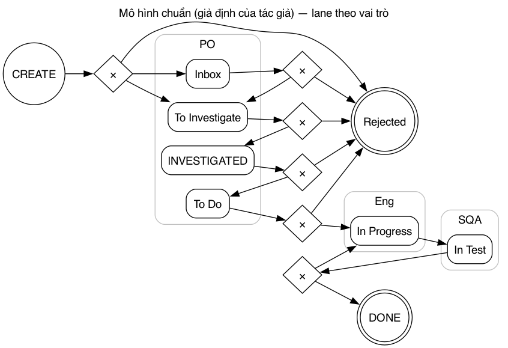
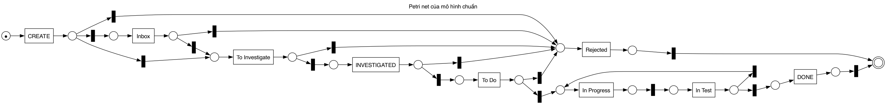
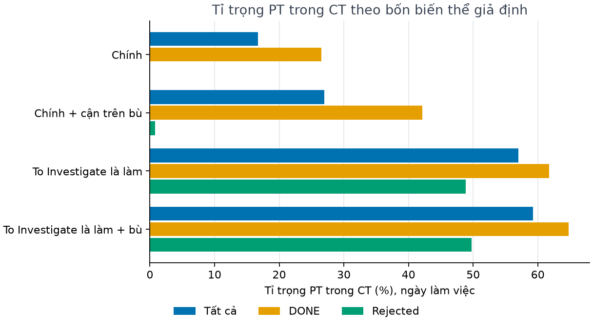
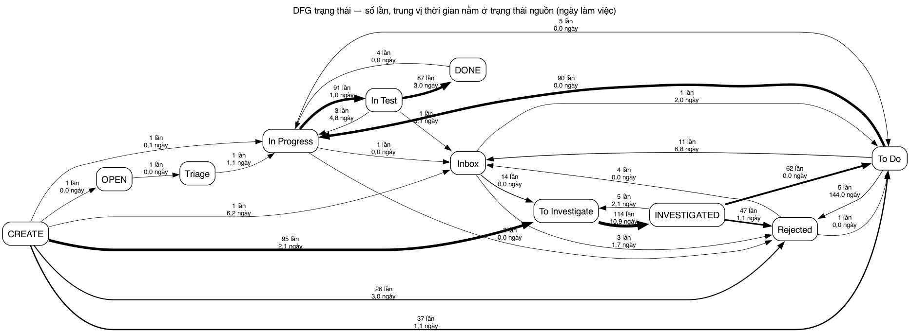
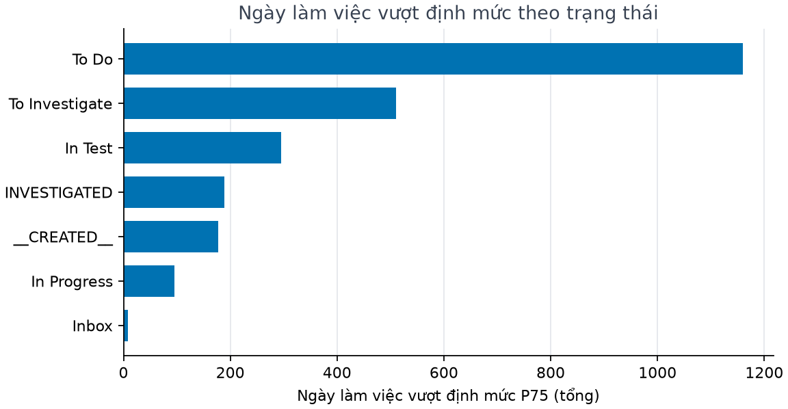
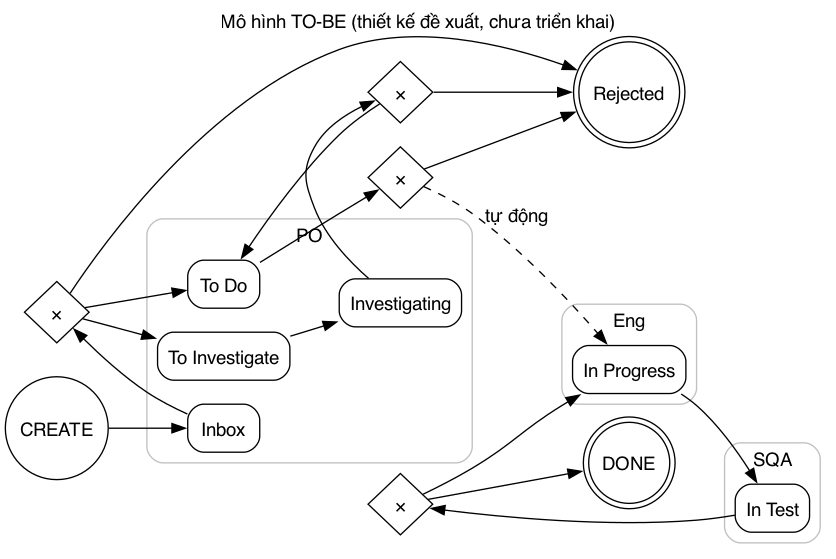
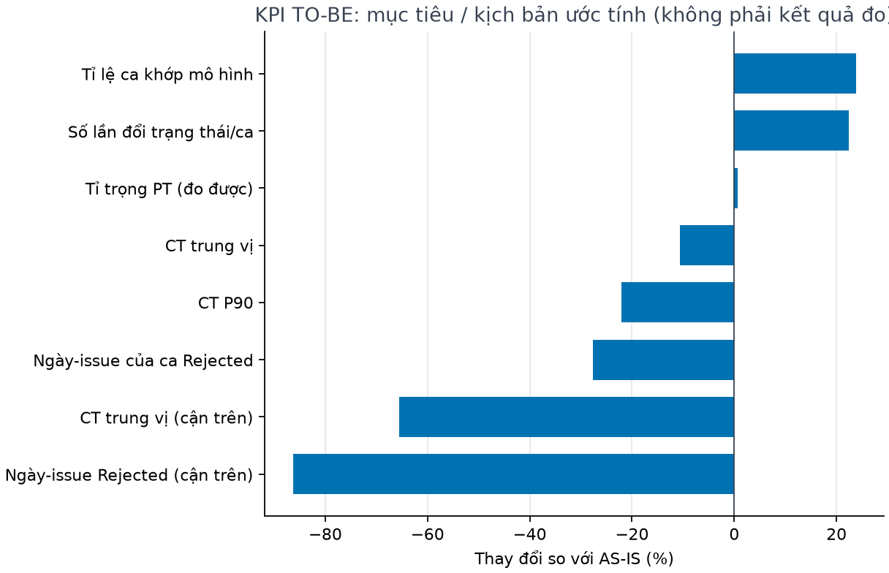
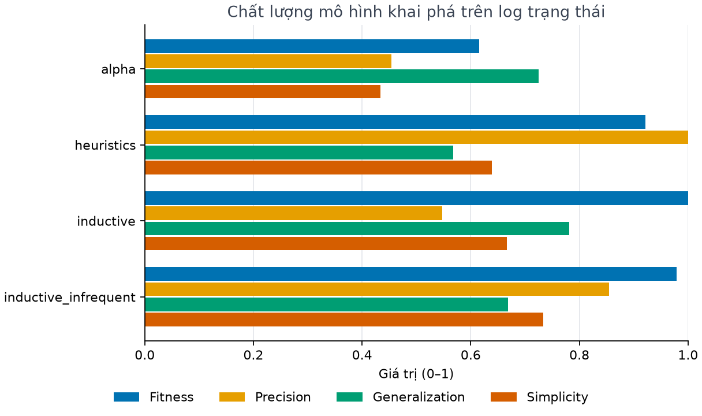
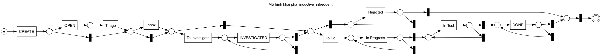
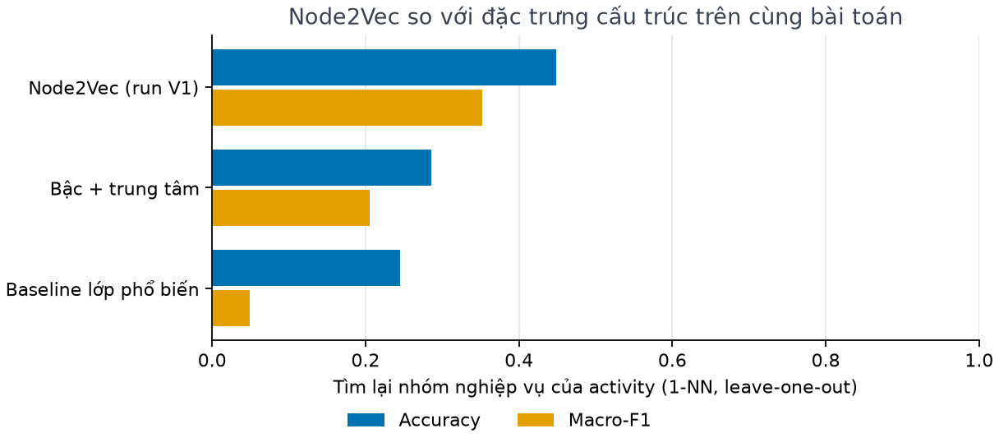

# Tóm tắt

Báo cáo này phân tích quy trình xử lý lỗi phần mềm của một team phát triển dựa trên nhật ký sự kiện (event log) xuất từ Jira. Dữ liệu gồm 161 bug đã đóng (83 được sửa – DONE, 78 bị từ chối – Rejected) với 5.126 sự kiện, trong giai đoạn từ tháng 6/2021 đến tháng 8/2022. Đồ án vận dụng kiến thức của sáu buổi học để trả lời bốn câu hỏi quản trị.

| Câu hỏi | Trả lời ngắn | Chương |
|---|---|---|
| 1. Quy trình thực tế chạy thế nào? | Phần lớn ca đi theo đúng trình tự Jira nhưng có nhiều đường tắt và quay lui. 105/161 ca (65,2%) khớp hoàn toàn với mô hình chuẩn; ở nhánh DONE chỉ 39/83 ca (47,0%). | 1, 5 |
| 2. Thời gian đi đâu, vai trò nào là điểm nghẽn? | Thời gian chu trình (CT) trung vị là 17,0 ngày làm việc. Thời gian dồn vào trạng thái To Investigate (trung vị 10,9 ngày mỗi lượt) và To Do (48% tổng số ngày vượt định mức, phần lớn từ một số ca nằm chờ rất lâu rồi bị từ chối). Dữ liệu không cho thấy một vai trò cụ thể gây chờ. Tỉ trọng thời gian xử lý chỉ ước lượng được trong khoảng 16,7%–59,2%, vì Jira không có trạng thái "đang điều tra". | 2, 3 |
| 3. Bao nhiêu ca lệch chuẩn, lệch ở đâu? | Lệch nhiều nhất là bỏ qua bước điều tra (CREATE → To Do, 37 ca, đa số là quyết định thật), lùi trạng thái (23 ca) và lùi về Inbox (To Do → Inbox, 11 ca). 17/23 ca lùi trạng thái chỉ lùi trong các đợt cập nhật dồn, nhiều khả năng là sửa thao tác. Danh sách đồng thuận gồm 10 ca nên ưu tiên xem lại, mỗi ca có lý do cụ thể. | 5, 6 |
| 4. Tái thiết kế ra sao, đo bằng KPI gì? | 5/7 phương án cải tiến được dữ liệu ủng hộ. Lợi ích chính là đo được công sức điều tra (thêm trạng thái Investigating), phân loại sớm tại Inbox và rà soát backlog To Do định kỳ. Mức rút ngắn CT là vừa phải: theo kịch bản thực tế, CT trung vị giảm từ 17,0 xuống 15,2 ngày làm việc (giảm 10,7%); cận trên lý tưởng 5,9 ngày (giảm 65,5%) không khả thi vì 47/78 ca Rejected chỉ bị loại sau khi đã điều tra. Các số TO-BE là mục tiêu / kịch bản ước tính. | 4 |

**Giả định về dữ liệu** (áp dụng cho mọi chương có số đo thời gian):

- Jira chỉ ghi thời điểm đổi trạng thái, không ghi thời điểm bắt đầu và kết thúc từng công việc. Vì vậy thời gian xử lý (PT) và thời gian chờ (WT) là các giá trị xấp xỉ, phụ thuộc cách phân loại trạng thái.
- Dữ liệu không có số nhân sự hay giờ công. Năng lực được đo qua thông lượng; phân tích nguồn lực dừng ở mức vai trò (PO, Eng, SQA…), không đánh giá cá nhân.
- 43,5% sự kiện do bot tạo ra. Khoảng 30% lần đổi trạng thái là cập nhật dồn: đổi trong vòng 60 giây sau lần đổi trạng thái trước, không tính lần đổi đầu tiên sau khi tạo. Một đợt cập nhật dồn là chuỗi các lần đổi như vậy, kể cả lần đổi mở đầu chuỗi.
- Ngày làm việc là thứ Hai đến thứ Sáu theo giờ địa phương lấy từ múi giờ ghi trong dữ liệu, mỗi ngày tính đủ 24 giờ, không trừ ngày lễ.
- Dữ liệu chỉ gồm các ca đã đóng, nên kết quả chỉ phục vụ phân tích hồi cứu, không dùng để phát hiện sớm.
- Theo kịch bản của đồ án, dữ liệu được coi là của công ty; nguồn gốc thực là bộ dữ liệu công khai đi kèm một bài báo khoa học về khai phá quy trình từ Jira (xem Phụ lục).

# Chương 1. Hệ thống làm việc và mô hình quy trình chuẩn

*Chương này vận dụng Buổi 1: khung Work System (8 thành phần) để mô tả hệ thống làm việc, và BPMN 2.0 (pool, lane, gateway) để mô hình hóa quy trình chuẩn.*

## 1.1 Hệ thống làm việc (Work System)

| Thành phần | Nội dung | Dẫn chứng từ dữ liệu |
|---|---|---|
| Khách hàng | Người dùng gặp lỗi (giả định đề bài) và các vai trò nội bộ báo lỗi | Vai trò tạo issue (5 nhóm lớn nhất): Eng 54, SQA 44, unknown 26, PO 16, thiếu vai trò 11, … |
| Sản phẩm/dịch vụ | Lỗi được sửa (DONE) hoặc quyết định không sửa (Rejected); thay đổi mã nguồn liên kết với commit/merge request | DONE 83, Rejected 78; 342 sự kiện liên kết commit, 95 sự kiện liên kết merge request |
| Quy trình và hoạt động | Chuỗi trạng thái Jira, xen kẽ các hoạt động sửa thông tin, giao việc, liên kết | 10 trạng thái, 30 biến thể trạng thái, 49 loại hoạt động |
| Người tham gia | Các vai trò con người | PO 1.296, Eng 489, SQA 168, RTE 43 sự kiện…; không xác định: unknown 837, thiếu vai trò 15 |
| Thông tin | Mô tả lỗi, liên kết issue, phân loại backlog, phiên bản sửa, epic | Thêm liên kết issue 384, sửa mô tả 357, cập nhật phân loại backlog 134 |
| Công nghệ | Jira tích hợp hệ thống quản lý mã nguồn qua bot | Bot tạo 2.230/5.126 sự kiện (43,5%) |
| Môi trường | Một team trong công ty phần mềm lớn, có áp lực phát hành | 47 lần cập nhật trường "chặn phát hành" |
| Hạ tầng | Máy chủ Jira, Git/merge request (giả định đề bài; log không mô tả trực tiếp) | Dấu vết tích hợp: 342 + 95 sự kiện liên kết |

## 1.2 Mô hình quy trình chuẩn

Mô hình chuẩn do tác giả xây dựng dựa trên quy trình Jira của team.

- **Trình tự chính:** Inbox → To Investigate → INVESTIGATED → To Do → In Progress → In Test → DONE.
- **Nhánh từ chối:** từ các trạng thái trước In Progress có nhánh lựa chọn (XOR) rẽ sang Rejected.
- **Vòng lặp:** In Test → In Progress khi kiểm thử không đạt.
- **Giả định:** việc tạo issue tương đương với đưa issue vào Inbox, vì Jira không ghi lại trạng thái khởi tạo này như một sự kiện riêng.

Lane được gán theo vai trò thường hoàn tất bước, tức vai trò chuyển ca ra khỏi trạng thái nhiều nhất:

- PO cho Inbox, To Investigate, INVESTIGATED, To Do;
- Eng cho In Progress;
- SQA cho In Test.





# Chương 2. Phân tích định lượng: thời gian đi đâu?

*Chương này vận dụng Buổi 2: CT = PT + WT, hiệu suất chu trình CTE = PT/CT, định luật Little, năng lực đo qua thông lượng, tỉ lệ đạt ngay lần đầu (FPY).*

PT và WT là xấp xỉ nên được báo cáo thành khoảng giữa bốn biến thể:

- **Hai cách phân loại "làm":** (a) phương án chính, gồm In Progress và In Test; (b) phương án độ nhạy, xếp thêm To Investigate vào "làm".
- **Hai phiên bản cho mỗi cách:** nguyên trạng; và cận trên, khi tính là "làm" cả khoảng thời gian ngay trước một đợt cập nhật dồn có đi qua trạng thái làm (người dùng làm việc thật rồi mới chuyển trạng thái dồn một lúc).

Mọi số liệu tính theo ngày làm việc, trừ khi ghi khác.

## 2.1 Bảng KPI hiện trạng (AS-IS)

| KPI | Bug | Story (để đối chiếu) |
|---|---|---|
| Số ca | 161 | 182 |
| CT trung vị (ngày làm việc / ngày lịch) | 17,0 / 23,0 | 19,3 / 27,3 |
| CT phân vị 90 (ngày làm việc) | 74,3 | 54,8 |
| Tỉ trọng PT (khoảng giữa bốn biến thể) | 16,7%–59,2% | 28,0%–31,9% |
| FPY nghiêm ngặt / điều chỉnh | 0,814 / 0,957 | 0,945 / 0,967 |
| Thông lượng trung bình (ca/tuần) | 2,8 | 3,3 |
| WIP trung bình (ca) | 18,4 | 17,0 |
| Tỉ lệ lần đổi trạng thái là cập nhật dồn | 29,8% | 14,1% |



## 2.2 Phát hiện

- **Kết luận "thời gian xử lý chiếm bao nhiêu" phụ thuộc gần như hoàn toàn vào cách hiểu To Investigate.**
  - Theo phân loại chính, PT chiếm 16,7% CT; nếu To Investigate được tính là "làm" thì con số này là 57,0%.
  - To Investigate là trạng thái tốn thời gian nhất: trung vị 10,9 ngày mỗi lượt, tổng cộng 2.109,6 ngày làm việc.
  - Đây là vấn đề đo lường: Jira không ghi lại phần điều tra diễn ra bên trong trạng thái này.
  - Story không có trạng thái To Investigate, nên khoảng hẹp của story không so sánh được với bug.
- **Nhánh Rejected tốn nhiều thời gian trước khi bị loại.**
  - 78 ca Rejected tiêu tốn 1.928,6 ngày-issue làm việc, trung vị 13,4 ngày mỗi ca.
  - Chỉ 1 ca kết thúc Rejected sau khi đã vào In Progress, nên công sức chủ yếu mất ở giai đoạn chờ và điều tra.
  - Cờ quy tắc ở Chương 5 đếm 2 ca, vì tính cả ca TI-4584: bị từ chối giữa chừng, sau đó mở lại và kết thúc DONE.
- **Định luật Little:** λ = 0,413 ca/ngày, W = 45,6 ngày, L = 18,8 ca.
  - Với log chỉ gồm ca đã đóng, L = λ·W là một đồng nhất thức.
  - Điểm đáng chú ý nằm ở chỗ khác: số ca đến trong nửa đầu kỳ là 109, nửa sau chỉ 52. Đây là dấu hiệu thiên lệch sống sót (các ca còn mở cuối kỳ không có trong log) hoặc lượng việc giảm, nên số liệu này không dùng để dự báo.
- **Vai trò "cổng"** (vai trò chuyển ca vào trạng thái): PO cho To Investigate (91%), Rejected (88%), To Do (75%); Eng cho In Test; SQA cho DONE (54%).
- **FPY:** 30 ca có lùi trạng thái hoặc mở lại, nhưng chỉ 7 ca có lần lùi/mở lại nằm ngoài các đợt cập nhật dồn; phần còn lại nhiều khả năng là sửa thao tác. Vì vậy FPY điều chỉnh là 0,957, so với FPY nghiêm ngặt 0,814.

# Chương 3. Định mức đúng/trễ và độ đo trung tâm

*Chương này vận dụng Buổi 3: event log, định mức đúng/trễ theo trạng thái, vai trò và ca; đồ thị DFG và các độ đo trung tâm (degree, betweenness, closeness, eigenvector, PageRank).*

**Cách đặt định mức.**

- Công ty không có cam kết thời gian (SLA) chính thức.
- Định mức được đặt bằng phân vị 0,75 của thời gian nằm ở mỗi trạng thái trong lịch sử, tính theo ngày làm việc, và chỉ áp dụng cho trạng thái có từ 10 lượt trở lên.
- Theo cách xây dựng, khoảng 25% số lượt ở mỗi trạng thái sẽ "trễ". Vì vậy các trạng thái được so sánh theo **số ngày vượt định mức**, không theo tỉ lệ trễ.
- Khi có SLA thật, có thể thay ngưỡng này trong cấu hình.

## 3.1 Định mức và số ngày vượt định mức

| Trạng thái | Định mức P75 (ngày) | Ngày vượt định mức | Tỉ trọng | Vai trò cổng |
|---|---|---|---|---|
| To Do | 7,8 | 1.159,3 | 48% | PO |
| To Investigate | 27,9 | 510,6 | 21% | PO |
| In Test | 9,8 | 295,3 | 12% | Eng |
| INVESTIGATED | 2,2 | 188,6 | 8% | PO |
| Từ lúc tạo tới lần đổi trạng thái đầu | 4,0 | 177,6 | 7% | — |
| In Progress | 3,0 | 95,6 | 4% | PO |





- **To Do là ưu tiên số 1.** Trung vị thời gian ở To Do gần bằng 0, vì khoảng một nửa số lượt chỉ kéo dài vài giây khi chuyển trạng thái dồn. Tuy nhiên một số ca nằm chờ rất lâu; lớn nhất là ca TI-5200, nằm 149,9 ngày ở To Do rồi bị từ chối.
- **Theo vai trò chuyển ca ra khỏi trạng thái:**
  - PO gắn với 1.298,1 ngày vượt định mức qua 390 lần chuyển, Eng 222,7 ngày, SQA 171,3 ngày.
  - Phần không xác định được vai trò (unknown) là 742,9 ngày, nên bảng vai trò chưa đầy đủ.
  - Vai trò chuyển ca ra chỉ là người ghi nhận bước kết thúc, không phải nguyên nhân của thời gian chờ.
- 99 ca có ít nhất một lượt trễ; 41 ca có CT vượt phân vị 75 của nhánh.

## 3.2 Độ đo trung tâm

- Trên DFG trạng thái, In Progress có betweenness cao nhất (0,367) và PageRank cao nhất (0,245): mọi luồng sửa lỗi đều đi qua trạng thái này.
- Các trạng thái có nhiều ngày vượt định mức nhất (To Do, To Investigate) không phải các nút trung gian nhất. Như vậy độ trễ nằm ở các hàng đợi trước điểm làm việc chính, không nằm ở chính điểm đó.
- Trên DFG mức hoạt động (tập huấn luyện), "sửa mô tả" (betweenness 0,231) và "thêm liên kết issue" (0,180) là hai hoạt động kết nối nhiều nhất. Điều này phù hợp với vai trò của mô tả lỗi và liên kết trong việc điều tra.

# Chương 4. Tái thiết kế quy trình (BPR): từ AS-IS đến TO-BE

*Chương này vận dụng Buổi 4: BPR với AS-IS/TO-BE, bài học Ford/Mazda và bảng KPI; cùng các nguyên tắc tái thiết kế (BPR heuristics) của Buổi 2.*

**Cách kiểm chứng phương án.**

- Mỗi phương án cải tiến được kiểm chứng trên dữ liệu bằng một câu hỏi đo được.
- Ngưỡng kết luận được cố định trước khi tính: 1 tuần làm việc = 5 ngày; "đáng kể" = 20%; "đa số" = 50%; khoảng tin cậy 95% không chứa 0.
- Các số TO-BE được tính lại trên chính log hiện có (phân tích what-if). Chúng không phải kết quả mô phỏng hay kết quả đã triển khai, và thường là cận trên.

## 4.1 Vấn đề → bằng chứng → nguyên tắc → kiểm chứng

| Vấn đề | Bằng chứng | Nguyên tắc BPR | Kết luận |
|---|---|---|---|
| Ca bị từ chối vẫn nằm lâu trước khi bị loại | 78 ca Rejected chiếm 36,8% ngày-issue; trung vị 13,4 ngày tới khi bị loại; nhưng 47/78 ca bị loại ngay sau INVESTIGATED, tức cần điều tra trước khi quyết định | Phân loại / loại sớm (tại Inbox với ca rõ ràng, ngay khi kết thúc điều tra với các ca còn lại) | Ủng hộ (đo được quy mô vấn đề; chưa đo được bao nhiêu ca có thể quyết định sớm hơn) |
| Trạng thái Jira cập nhật muộn so với công việc thật | 39/58 ca (67,2%) có commit/merge request trước khi chuyển In Progress; liên kết đầu tiên rơi vào To Investigate 22 ca, To Do 12 ca, trước lần đổi trạng thái đầu 5 ca | Tự động hóa: tự chuyển In Progress khi có commit/merge request | Ủng hộ, nhưng quy tắc tự động To Do → In Progress chỉ áp dụng cho 12 ca |
| INVESTIGATED chỉ là bước đi xuyên qua | 43/62 lần (69,4%) chuyển sang To Do trong không quá 1 ngày | Gộp bước: gộp INVESTIGATED vào To Do | Ủng hộ |
| PO là cổng của phần lớn trạng thái chờ | Trung vị thời gian chờ ở To Do như nhau giữa lượt do PO và do vai trò khác chuyển ra (khoảng tin cậy 95% chứa 0) | Trao quyền / phân quyền | Không ủng hộ |
| Bug trùng bị phát hiện muộn | 7 ca trùng bị loại sau trung vị 3,2 ngày, tức đã khá nhanh | Kiểm tra trùng ngay khi tạo | Không ủng hộ |
| Công sức điều tra không hiện trong Jira | PT 16,7% so với 57,0% tùy cách hiểu To Investigate | Thêm điểm đo: trạng thái Investigating | Ủng hộ |
| Mọi bug đều phải qua điều tra | Ca DONE bỏ điều tra (32 ca): CT 11,2 ngày, FPY 0,75; ca DONE có điều tra (51 ca): CT 35,9 ngày, FPY 0,76 | Phân luồng: luồng nhanh cho bug rõ ràng | Ủng hộ (chỉ là quan sát, không phải quan hệ nhân quả: chênh CT một phần do bỏ luôn thời gian ở To Investigate, và bug được sửa thẳng có thể vốn đơn giản hơn) |

**Về giả thuyết liên quan đến PO.**

- Giả thuyết "thời gian chờ ở To Do gắn với PO" không được ủng hộ theo phép kiểm định đã cố định trước (so sánh trung vị).
- Phân tích mô tả sau đó cho thấy 60,5% số ngày vượt định mức ở To Do rơi vào các lượt do PO chuyển ra. Tuy nhiên 75,3% phần này (527,9 ngày) đến từ đúng 4 lượt PO chuyển To Do → Rejected.
- Đây giống việc dọn backlog cũ hơn là PO làm chậm việc sửa lỗi. Đề xuất phù hợp là rà soát backlog To Do định kỳ, không phải phân quyền lại.

**Bài học Ford/Mazda.**

- Ford không đẩy nhanh bước đối chiếu hóa đơn mà loại bỏ hẳn bước đó. Tương tự, thay vì nhắc người dùng cập nhật trạng thái, có thể để commit/merge request tự chuyển trạng thái In Progress.
- Mazda cho thấy giá trị của việc so sánh một quy trình với một cách làm khác. Tương tự, luồng "bỏ điều tra" và luồng có điều tra của chính team chênh nhau rất xa về CT. Đây là gợi ý để thử phân luồng tại Inbox trong giai đoạn thí điểm, chưa phải bằng chứng rằng phân luồng sẽ rút ngắn CT.

## 4.2 Mô hình TO-BE

Mô hình TO-BE chỉ gồm các phương án được dữ liệu ủng hộ:

- **Tạo issue → Inbox (phân loại).** Từ Inbox, issue đi một trong ba hướng:
  - Rejected, nếu bị loại sớm;
  - To Do, nếu là bug rõ ràng (luồng nhanh);
  - To Investigate → Investigating, nếu cần điều tra. Sau khi điều tra, issue sang To Do hoặc Rejected.
- **To Do → In Progress**, chuyển tự động khi có commit/merge request.
- **In Progress → In Test**, từ đó quay lại In Progress hoặc kết thúc ở DONE.

Lane của To Investigate và Investigating (PO) dựa trên số liệu còn mỏng và chỉ là đề xuất.



## 4.3 KPI hiện trạng (đo được) và TO-BE (mục tiêu / kịch bản ước tính)

| KPI | AS-IS (đo được) | TO-BE (mục tiêu / kịch bản ước tính) | Kịch bản và giả định |
|---|---|---|---|
| CT trung vị (ngày làm việc), kịch bản thực tế | 17,0 | 15,2 (giảm 10,7%) | Ca Rejected đã qua điều tra được quyết định ngay khi kết thúc điều tra (bỏ thời gian chờ ở INVESTIGATED và sau đó), và thời gian chờ ở To Do không quá định mức |
| CT phân vị 90 (ngày làm việc), kịch bản thực tế | 74,3 | 57,9 (giảm 22,1%) | Như trên |
| CT trung vị (ngày làm việc), cận trên lý tưởng | 17,0 | 5,9 (giảm 65,5%) | Mọi ca Rejected được quyết định ngay ở lần đổi trạng thái đầu. Không khả thi, vì 47/78 ca Rejected chỉ bị loại sau khi đã điều tra và TO-BE vẫn giữ nhánh Investigating → Rejected |
| Ngày-issue của ca Rejected, kịch bản thực tế | 1.928,6 | 1.394,2 (giảm 27,7%) | Quyết định ngay khi kết thúc điều tra |
| Ngày-issue của ca Rejected, cận trên lý tưởng | 1.928,6 | 264,2 (giảm 86,3%) | Thông tin để từ chối đã có từ lần đổi trạng thái đầu (không khả thi, như trên) |
| Tỉ trọng PT đo được | 16,7% | 16,9% | Phần To Do sau commit/merge request đầu tiên được tính là "làm" (cải thiện đo lường, CT không đổi); chưa tính phần Investigating vì chưa đo được |
| Số lần đổi trạng thái mỗi ca | 4,4 | 5,4 | Đường đi hiện trạng được chuyển sang đường TO-BE: bỏ INVESTIGATED, thêm Investigating, đi qua Inbox một cách tường minh |
| Tỉ lệ ca khớp mô hình | 65,2% | 80,7% | So với mô hình cho phép luồng nhanh: thay đổi chuẩn so sánh, hành vi không đổi |



**Thông điệp của chương.** Phương án tái thiết kế không hứa hẹn rút ngắn CT nhiều: theo kịch bản thực tế, CT trung vị chỉ giảm khoảng một phần mười (17,0 → 15,2 ngày làm việc). Giá trị chính nằm ở ba điểm:

1. **Đo được công sức điều tra.** Tách To Investigate (hàng đợi) khỏi Investigating (đang làm), để biết thời gian thực sự đi đâu; hiện nay tỉ trọng PT chỉ ước lượng được trong khoảng 16,7%–59,2%.
2. **Phân loại sớm tại Inbox.** Bug rõ ràng đi luồng nhanh; bug cần điều tra được quyết định từ chối ngay khi điều tra xong, không phải chờ thêm ở INVESTIGATED hay To Do.
3. **Rà soát backlog To Do định kỳ.** Phần lớn số ngày vượt định mức ở To Do đến từ một vài ca nằm chờ hàng trăm ngày rồi mới bị từ chối.

Cận trên 5,9 ngày chỉ cho biết giới hạn lý thuyết, không phải mục tiêu.

- **TO-BE thêm bước chứ không bớt bước.** Số lần đổi trạng thái mỗi ca tăng, vì mục tiêu của trạng thái Investigating và Inbox tường minh là làm cho việc điều tra và phân loại đo được.
- **Tự chuyển trạng thái chỉ cải thiện đo lường một chút** (16,7% → 16,9%). Lý do là lần liên kết commit/merge request đầu tiên hiếm khi rơi vào To Do (12/39 ca); phần lớn rơi vào To Investigate (22 ca). Đây thêm một dấu hiệu rằng công việc thực sự đang diễn ra trong To Investigate, ủng hộ đề xuất thêm trạng thái Investigating.

## 4.4 Kế hoạch thí điểm

| Giai đoạn | Tuần | Công việc | KPI theo dõi (mốc AS-IS) |
|---|---|---|---|
| Chuẩn bị | 1–2 | Cấu hình Jira: thêm Investigating, bỏ INVESTIGATED, tự chuyển In Progress; họp phân loại hằng ngày tại Inbox | Số lần đổi trạng thái mỗi ca (4,4; đường TO-BE dự kiến 5,4), tỉ trọng PT (16,7%) |
| Chạy thử | 3–8 | Áp dụng quy trình TO-BE với một team | CT trung vị (17,0), ngày-issue Rejected (1.928,6), tỉ lệ ca khớp mô hình TO-BE (mốc AS-IS so với mô hình luồng nhanh: 65,2%) |
| Đánh giá | 9–10 | So sánh KPI thí điểm với mốc AS-IS theo cùng định nghĩa; tiếp tục nếu KPI chính đi đúng hướng và khoảng tin cậy không chứa 0 | CT trung vị, CT phân vị 90 (74,3), ngày-issue Rejected, tỉ lệ ca khớp |

# Chương 5. Khai phá quy trình AS-IS và kiểm định tuân thủ

*Chương này vận dụng Buổi 5: khai phá quy trình bằng Alpha, Heuristics và Inductive Miner; Petri net; kiểm định tuân thủ bằng token replay (fitness, precision, generalization, simplicity).*

## 5.1 Khai phá quy trình hiện trạng (log mức trạng thái, 161 ca)

| Mô hình | Fitness | Precision | Generalization | Simplicity | % ca khớp |
|---|---|---|---|---|---|
| Alpha | 0,616 | 0,453 | 0,725 | 0,433 | 0% |
| Heuristics | 0,921 | 1,000 | 0,567 | 0,639 | 37,9% |
| Inductive | 1,000 | 0,548 | 0,781 | 0,667 | 100% |
| Inductive (lọc nhiễu 0,2) | 0,979 | 0,855 | 0,669 | 0,733 | 78,3% |



Không mô hình khai phá nào vừa khớp với mọi ca vừa chặt chẽ:

- Alpha không xử lý được vòng lặp và nhiễu.
- Inductive khớp mọi ca nhưng cho phép quá nhiều đường đi.
- Bản Inductive có lọc nhiễu là mô tả hiện trạng cân bằng nhất.



## 5.2 Token replay trên mô hình chuẩn

| | Tất cả | DONE | Rejected |
|---|---|---|---|
| Ca khớp hoàn toàn | 105/161 (65,2%) | 39/83 (47,0%) | 66/78 (84,6%) |
| Fitness trung bình theo ca | 0,967 | 0,952 | 0,984 |

**Vì sao fitness là 0,965 nhưng chỉ 65,2% ca khớp hoàn toàn.**

- Hai chỉ số đo hai đại lượng khác nhau. Fitness theo token đo tỉ lệ token được tiêu thụ và sinh ra đúng trên toàn log; tỉ lệ ca khớp hoàn toàn đếm số ca không sai bước nào.
- Một ca chỉ đi sai một cung (ví dụ CREATE → To Do thay vì qua điều tra) thiếu một token và thừa một token, trên tổng khoảng mười mấy token của cả chuỗi. Fitness của ca đó vẫn cao, nhưng ca không còn "khớp hoàn toàn".
- Thực tế, 56 ca không khớp vẫn có fitness trung bình 0,906 (thấp nhất 0,833).
- Vì vậy fitness gần 1 không có nghĩa là quy trình được tuân thủ tốt. Câu hỏi 3 được trả lời bằng tỉ lệ ca khớp hoàn toàn; fitness dùng để so sánh mức lệch giữa các mô hình.

**Precision.** Precision của mô hình chuẩn là 0,915. Nếu bỏ cung To Investigate → Rejected (chưa từng xảy ra nhưng được tác giả giữ lại vì là đường đi hợp lệ về nghiệp vụ) thì precision là 0,991, fitness không đổi.

**Mô hình "luồng nhanh".** Mô hình này bằng mô hình chuẩn cộng thêm cung CREATE → To Do; nó không phải mô hình chuẩn mà là một phương án TO-BE. Với mô hình này có 130 ca khớp (80,7%), giải thích thêm 25 ca, chủ yếu ở nhánh DONE.

## 5.3 Sai lệch nằm ở đâu

| Sai lệch | Số ca | DONE | Rejected | Số lần / trong đợt cập nhật dồn | Ca chỉ lệch trong đợt cập nhật dồn |
|---|---|---|---|---|---|
| CREATE → To Do (bỏ điều tra) | 37 | 30 | 7 | 37 / 9 | 9 |
| To Do → Inbox | 11 | 6 | 5 | 11 / 10 | 10 |
| Lùi trạng thái | 23 | 16 | 7 | 26 / 20 | 17 |
| Mở lại (rời DONE hoặc Rejected) | 8 | 5 | 3 | 9 / 8 | 7 |

- **Cờ quy tắc** (chỉ đếm, không kết luận là lỗi), không cờ nào bằng 0:

  | Cờ | Số ca |
  |---|---|
  | Đổi trạng thái trong đợt cập nhật dồn | 69 (42,9%) |
  | Bỏ bước điều tra | 39 |
  | Lần đổi trạng thái đầu là Rejected | 26 |
  | Lùi về Inbox | 17 |
  | Vào In Progress không qua To Do | 6 |
  | Mở lại sau DONE | 4 |
  | Bị từ chối sau khi đã vào In Progress | 2 |

- **Hai cách đếm khác nhau cần phân biệt:**
  - 22 ca có đúng biến thể To Do → In Progress → In Test → DONE.
  - 37 ca có cung CREATE → To Do.
  - Cờ "bỏ bước điều tra" đếm 39 ca, vì tính mọi ca vào To Do, In Progress, In Test hoặc DONE khi chưa từng điều tra, kể cả ca đi thẳng vào In Progress hoặc qua các trạng thái hiếm OPEN/Triage.
  - Tương tự, 22 ca chỉ có CREATE → Rejected, còn cờ đếm 26 ca có lần đổi trạng thái đầu là Rejected (trong đó 4 ca sau đó được mở lại).
- **Ví dụ issue:** bỏ điều tra TI-4751, TI-4759; lùi về Inbox TI-4748, TI-5118; mở lại TI-4584, TI-5362.
- **Diễn giải:**
  - 17/23 ca lùi trạng thái và 7/8 ca mở lại chỉ lệch trong các đợt cập nhật dồn, nên nhiều khả năng là sửa thao tác.
  - Ngược lại, phần lớn các lần CREATE → To Do nằm ngoài đợt cập nhật dồn (28 ca): đây là quyết định bỏ điều tra thật.

# Chương 6. Học biểu diễn đồ thị và danh sách ca nên ưu tiên xem lại

*Chương này vận dụng Buổi 6: Node2Vec, sử dụng lại embedding đã huấn luyện trong phần phát hiện bất thường của đồ án (không huấn luyện lại). Graph2Vec được nêu như hướng mở rộng.*

## 6.1 Node2Vec có học được ý nghĩa nghiệp vụ của hoạt động không?

Bài toán đặt ra: từ biểu diễn của 49 hoạt động, tìm lại nhóm nghiệp vụ của chúng (trạng thái, mã nguồn, giao việc, kế hoạch, liên kết, tài liệu, phân loại).

| Biểu diễn | Accuracy (1-NN, leave-one-out) | Macro-F1 |
|---|---|---|
| Node2Vec | 0,449 | 0,352 |
| Bậc + độ đo trung tâm | 0,286 | 0,205 |
| Baseline lớp phổ biến | 0,245 | 0,049 |



- Node2Vec đặt các hoạt động cùng nhóm nghiệp vụ gần nhau tốt hơn đặc trưng cấu trúc.
- Tuy vậy, cấu trúc cụm còn yếu: silhouette tối đa 0,137, NMI tối đa 0,388 với K = 6.
- Kết quả này bổ sung cho kết luận của phần phát hiện bất thường trước đó, nơi Node2Vec không giúp phát hiện bất thường tốt hơn thống kê chuyển tiếp.

## 6.2 Danh sách ca nên ưu tiên xem lại

**Cách xếp hạng.** Mỗi ca có hồ sơ 7 chiều:

- mức lệch so với mô hình chuẩn;
- số cờ quy tắc;
- số lượt trễ định mức;
- số lần lùi/mở lại;
- số lần đổi người phụ trách;
- số lần đổi trạng thái dồn;
- độ bất ngờ của chuỗi theo mô hình Markov (đã loại ảnh hưởng của độ dài).

Mỗi chiều được so sánh trong nhóm cùng nhánh (DONE/Rejected) và cùng độ dài; sau đó các ca được xếp hạng theo số chiều vượt phân vị 90.

- **Danh sách đồng thuận gồm 10 ca nên ưu tiên xem lại** (không đồng nghĩa với vi phạm). Đây là các ca nằm trong nhóm 10% đứng đầu ở ít nhất 70% số lần lấy mẫu lại (bootstrap) mà ca đó được chọn:
  - lọt nhóm đầu ở 100% số lần: TI-4584, TI-4671, TI-4748, TI-5260, TI-5564;
  - lọt nhóm đầu ở 87,6%–97,8% số lần: TI-4872, TI-5770, TI-6208, TI-5261, TI-6163.
- **Giới hạn: danh sách 17 ca đứng đầu không ổn định.**
  - Chỉ số Jaccard giữa nhóm 17 ca đứng đầu trên dữ liệu gốc và trên các mẫu bootstrap chỉ đạt 0,40 [0,21; 0,62].
  - Ví dụ, ca xếp hạng 4 (TI-5598) chỉ lọt nhóm đầu ở 65,9% số lần nên không có trong danh sách đồng thuận.
  - Vì vậy báo cáo chỉ dùng danh sách đồng thuận làm gợi ý rà soát, không dùng làm thước đo.
- **Không thiên về ca dài:** trung vị số sự kiện của nhóm 17 ca đứng đầu bằng của toàn bộ (19). Riêng thành phần "số chiều vượt" có tương quan nhẹ với độ dài (Spearman 0,121), còn điểm tổng gần như không tương quan (−0,005).
- **Không thiên nhiều về Rejected:** 52,9% so với 48,4% trên toàn bộ.
- **Loại bỏ ảnh hưởng độ dài có hiệu quả:** tương quan giữa độ bất ngờ Markov và độ dài giảm từ 0,507 xuống 0,040.
- **Bảng mù:** một bảng gồm 15 ca đứng đầu và 15 ca chọn ngẫu nhiên (đã xáo trộn) được chuẩn bị để người hiểu quy trình tự gán nhãn. Kết quả sẽ được so sánh bằng kiểm định Fisher chính xác, kèm khoảng tin cậy.

**Hướng mở rộng — Graph2Vec:** biểu diễn cả một ca thành một vector để gom cụm các kiểu xử lý. Phần này chưa thực hiện, vì 161 đồ thị nhỏ cho giá trị thấp so với chi phí; hướng này hợp lý hơn khi có dữ liệu của nhiều team.

# Kết luận

1. **Quy trình thực tế** phần lớn theo trình tự Jira, nhưng khoảng một phần ba số ca lệch khỏi mô hình chuẩn; ở nhánh DONE, chưa đến một nửa số ca khớp hoàn toàn. Lệch phổ biến nhất là đi thẳng vào To Do mà không qua điều tra, và lùi trạng thái.
2. **Thời gian** dồn vào To Investigate (chưa tách được chờ và điều tra) và To Do, không phải vào giai đoạn sửa (In Progress). Dữ liệu không xác định được vai trò nào gây ra thời gian chờ: giả thuyết về PO không được ủng hộ, và phần đuôi ở To Do chủ yếu là các ca backlog cũ bị từ chối.
3. **Đo lường là vấn đề cần giải quyết trước tiên.** Jira không tách "chờ điều tra" khỏi "đang điều tra", nên tỉ trọng thời gian xử lý chỉ ước lượng được trong một khoảng rất rộng.
4. **Đề xuất tái thiết kế:**
   - thêm trạng thái Investigating để đo được công sức điều tra;
   - phân loại sớm tại Inbox (luồng nhanh cho bug rõ ràng, từ chối ngay khi điều tra xong);
   - rà soát backlog To Do định kỳ;
   - gộp INVESTIGATED;
   - tự chuyển trạng thái theo commit/merge request.

   Mức rút ngắn CT là vừa phải: theo kịch bản thực tế, 17,0 → 15,2 ngày làm việc (giảm 10,7%); cận trên lý tưởng 5,9 ngày không khả thi. Hiệu quả chỉ được khẳng định sau giai đoạn thí điểm, đo lường theo cùng định nghĩa.

**Giới hạn.**

- Dữ liệu chỉ của một team, gồm 161 bug đã đóng, không có nhãn lỗi thật.
- Mô hình chuẩn và các nhóm nghiệp vụ là giả định của tác giả.
- PT/WT là các giá trị xấp xỉ.
- Số TO-BE là kịch bản ước tính trên dữ liệu cũ.
- So sánh luồng nhanh với luồng có điều tra là quan sát, không phải quan hệ nhân quả.

# Phụ lục A. Phương pháp thống kê và kiểm soát chất lượng

- Ngưỡng của các phép kiểm chứng phương án cải tiến và tham số xếp hạng được cố định trong cấu hình trước khi tính; mô hình TO-BE được thiết kế sau khi có kết luận kiểm chứng.
- Khoảng tin cậy được tính bằng bootstrap: 2000 lần cho chênh lệch trung vị (giả thuyết về PO), 200 lần cho độ ổn định của nhóm đứng đầu.
- Mã nguồn được kiểm thử tự động. Các phép tính số liệu (thời gian, định mức, replay, xếp hạng) được kiểm tra bằng kỹ thuật đột biến (cố ý làm sai mã để xác nhận kiểm thử phát hiện được).
- Mỗi bước phân tích có ít nhất một con số được tính lại độc lập từ dữ liệu thô, không dùng mã của dự án. Toàn bộ số liệu chính đã được một lần kiểm tra lại độc lập trước khi hoàn thiện báo cáo.
- Kết quả tất định: chạy lại cùng cấu hình cho cùng nội dung từng file kết quả.

# Phụ lục B. Tái lập

**Dữ liệu.** Bộ dữ liệu công khai `Zenodo 8275679`, đi kèm bài báo "Process Mining from Jira Issues at a Large Company" (`ICSME 2023`); sử dụng tệp `dataset/TIeventlogBug.csv` (bug) và `dataset/TIeventlogStory.csv` (story, chỉ để đối chiếu). Múi giờ gốc trong dữ liệu: `-0700`/`-0800`.

**Môi trường.** Python 3.12, quản lý gói bằng `uv` (tệp khóa `uv.lock`); khai phá quy trình bằng `pm4py`, vẽ sơ đồ bằng Graphviz.

**Lệnh tái lập toàn bộ kết quả:**

```bash
uv sync --locked --all-extras --group dev
uv run jira-ad process --config configs/process.yaml
uv run jira-ad notebooks --run-dir outputs/process/<run>
uv run jira-ad check-report --report docs/BAO_CAO_MON_HOC_nop.md --run-dir outputs/process/<run>
```

**Lần chạy được sử dụng trong báo cáo:** `outputs/process/20261026T025412Z-399b0a40`. Thư mục này có tệp `manifest.json` ghi mã băm sha256 của từng tệp kết quả, cấu hình và dữ liệu đầu vào. Mã băm của các tệp đầu vào chính:

| Tệp | sha256 (16 ký tự đầu) |
|---|---|
| `dataset/TIeventlogBug.csv` | `cda16f1c5c4af641` |
| `configs/baseline.yaml` | `2638fd50904a75eb` |
| `configs/actions.yaml` | `4a35ef7d0f48052a` |

**Tài liệu minh họa.** Các notebook `notebooks/07_quantitative.ipynb` đến `notebooks/12_summary_report.ipynb` trình bày chi tiết từng chương. Mọi con số trong báo cáo được đối chiếu tự động với tệp kết quả bằng lệnh `check-report` ở trên.
